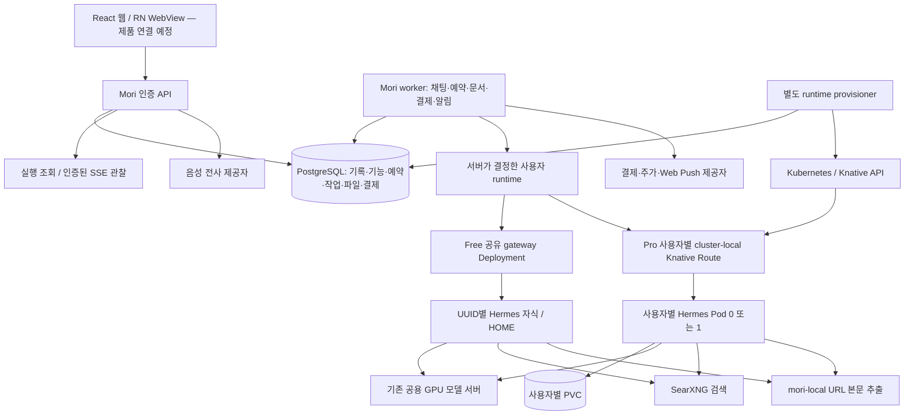

# Architecture — 시스템·인프라 설계

갱신일: 2026-11-04 · [전체 계획](../plan.md) · [운영 적용·검증 순서](runtime-operations-roadmap-2026-11-03.md)

## 1. 현재 기준과 상태 구분

현재 구현 기준은 `master` **6285aba**, Backend **0.9.0**, DB **0017_news_refresh_deadline**이다. 백엔드·Hermes·배포 예시는 Git에 반영했고, 이번 개발에서 새 이미지를 빌드하거나 운영 클러스터에 적용하지 않았다. PoC 화면도 새 API에 연결하지 않았다. “코드 구현”, “로컬 검증”, “운영 적용”, “실제 기기 인수”를 서로 다른 상태로 기록한다.

| 항목 | 현재 상태 | 아직 필요한 확인 |
| --- | --- | --- |
| Mori API·PostgreSQL | 사용자 데이터·기능·실행·결과·파일·결제 상태 저장 구현 | 운영 DB 이관·복원·실제 로그인 |
| 작업 worker | 지속 채팅·예약·문서·결제·Web Push 독립 loop와 heartbeat 구현 | 실제 이미지·제공자·재시작/자원 부하 검증 |
| 예약 원장·사전 기동 | Mori DB·worker 소유, 기본 120초 prewarm 구현 | 실제 Knative Route 기동·예약 지연 측정 |
| 무료 공용 Hermes | 공용 Deployment 안 사용자별 자식 프로세스·HOME 분리 구현 | 새 이미지의 stage2·UID·신호·CNI·모델 통합 |
| Pro 개인 Hermes | 사용자별 Knative Service·PVC·Secret 배정과 회수 구현 | 실제 RBAC·PVC·Knative·키/설정 교체 절차 검증 |
| 공용 검색 | SearXNG 연결·이미지 검색·본문 추출 코드와 과거 현장 기록 존재 | 최신 배포의 검색 엔진 제한·모델 도구 호출 재확인 |
| React 웹·RN 앱 | 웹 재사용과 제한된 브리지·독립 배포 방향 합의 | 제품 코드·웹 세션·기기 API·스토어 인수 |

이번 최종 검사에서 backend **726개 통과**, Hermes **91개 통과·1개 건너뜀·43 subtest 통과**를 확인했다. 건너뛴 항목은 로컬 Trafilatura 미설치 검사이며, 실제 제공자·Linux 이미지·클러스터·모바일·정상 HWP/HWPX 원본 전체 통합 검증을 대체하지 않는다. Ruff·포맷·OpenAPI·lockfile·migration 왕복·모델 일치 검사도 통과했다. [구현과 검사 상세](../back/implementation-status-2026-11-03.md).

9월 29일의 실제 Hermes **약 11초 0→1**과 **종료 코드 0** 기록은 당시 단일 시험 사용자·이미지·노드·캐시 조건의 관찰이다. 지금 작성한 다중 사용자 gateway·개인 런타임의 성능 또는 정상 종료가 새 환경에서도 동일하다는 증거로 쓰지 않는다. [당시 현장 기록](hermes-knative-validation-2026-09-29.md).

## 2. 현재 구현의 책임과 요청 경로

그림은 **코드의 책임 구조**다. 제품 UI 연결과 실제 배포가 완료되었다는 현황도가 아니다. API와 작업 worker에는 Kubernetes 자격 증명을 주지 않는다. 개인 환경 자원을 만드는 별도 provisioner만 `mori-agents`에 제한된 RBAC를 가진다. Hermes와 모델 서버는 내부 호출 경로에 둔다.

제품 기록·예약·기능 버전·실행 결과는 Mori DB가 기준이다. Hermes는 모델/도구 실행을 담당하고, Mori는 모델의 작업 제안을 소유권·입력 스키마·기능 버전·허용 작업·실행 lease로 확인한 뒤 저장한다. 일반 대화, 명시적인 기능 실행, 문서 작업 등록, 예약 회차의 완료를 같은 의미로 취급하지 않는다.

대시보드·기록·캘린더 조회와 정해진 알림은 Hermes 호출 없이 처리한다. 대화 실행은 `/runs`로 등록하고 `/events`로 관찰한다. SSE 재접속과 화면 종료는 실행 수명과 분리된다. 문서 작업은 별도 큐에서 처리하므로 채팅이 끝났어도 문서 결과 파일은 document-job에서 확인한다.

## 3. 예약은 Mori가 소유

**현재 합의와 구현은 Mori DB·worker가 예약 정의와 회차 실행을 관리하는 방식이다.** Hermes native cron에 같은 업무를 이중 등록하지 않는다. 과거 문서의 “Hermes가 cron을 보관하고 Mori가 깨우기만 한다”는 안은 현행 구조로 대체되었다.

1. 사용자 기능의 버전·예약·시간대를 Mori에 저장한다.
2. worker가 다음 발생 시각을 계산하고 회차를 DB에 생성한다.
3. Hermes가 필요한 실행에 한해 기본 120초 전 구간부터 인증된 `/v1/toolsets` 요청으로 배정된 Route를 깨운다. 정상 prewarm 뒤에는 회차가 도래할 때까지 제한된 간격으로 준비 상태를 갱신한다.
4. 예정 시각에 작업을 claim하고 고정된 버전·권한·원래 회차의 시간 문맥으로 실행한다.
5. 취소·수정·lease/generation을 재확인한 뒤 결과를 저장한다. 같은 회차의 중복 게시를 막고 실패는 제한적으로 재시도한다.
6. 결과의 표시 구간과 알림 전송 상태는 따로 조회한다.

prewarm 대상은 사용자 커스텀 기능과 AI 요약이 켜진 뉴스 등 Hermes가 필요한 예약이다. 기본 주가 수집·단순 기록 표시·정해진 알림마다 Hermes를 깨우지 않는다. 현재 한 번에 claim하는 prewarm 동시 수는 4이며 설정된 기본 준비 구간은 `MORI_AUTOMATION_PREWARM_SECONDS=120`이다. 이 숫자는 전체 GPU 처리량이나 모든 사용자의 동시 실행 보장이 아니다.

| 시간 | 의미 | 현재 해석 |
| --- | --- | --- |
| 실행 예정 시각 | 수집·분석 work를 시작할 회차 | DB 예약과 시간대 기준 |
| 사전 기동 시각 | 실행 전에 환경을 준비할 때 | 기본 120초 구간, 기동·추론 시간 실측 후 조정 |
| 표시 구간 | 대시보드에 결과·예정 카드를 보일 때 | 실행/알림과 별도 조회 규칙 |
| 알림 목표 시각 | 기기로 알림을 보내려는 때 | Web Push와 기기 수신·표시는 다른 단계 |
| 결과 도착 목표 | 사용자가 완료를 기대하는 시각 | 별도 제품/SLO 결정 필요, 정시 완료 보장은 미확정 |

늦게 재시도한 예약은 원래 `scheduled_at`과 기능 시간대를 기준으로 문맥을 구성한다. 어제의 메모 정리를 오늘 복구했다고 오늘 메모로 바꾸지 않는다. worker 재시작과 중복 호출에 대한 DB lease·버전 검증은 구현했지만, 외부 호출까지 무조건 exactly-once라고 약속하지 않는다.

## 4. Free 공용 환경과 Pro 개인 환경

### Free: 공유 Pod 안의 논리적 사용자 분리

현행 예시는 공용 **Deployment 1개·Pod 1개**다. 공용 부모 gateway가 UUID마다 Hermes 자식 프로세스와 HOME/HERMES_HOME·임시 경로·내부 API 키를 분리한다. 인증된 Mori 서버가 사용자를 정하며 클라이언트나 프롬프트의 ID를 신뢰하지 않는다. 동시에 살아 있는 자식 수 기본값 4, 유휴 회수 180초, 프로필 수 기본값 40을 운영 설정으로 제한한다.

검색 전용 도구(`web_search`, `web_extract`, `mori_image_search`)만 허용한다. 파일·터미널·임의 코드 실행을 공용 Hermes에 열지 않는다. 제품 문서는 Mori 문서 worker가 처리한다. 같은 Unix UID 안의 논리적 프로필 분리이며 OS·컨테이너별 보안 sandbox가 아니다. 프로필 기록량 검사는 파일시스템 hard quota도 아니다.

공용 부모 Deployment 자체를 현재 예시가 자동 scale-to-zero하는 것은 아니다. 유휴 자식을 회수하는 정책과 Pro Knative Pod의 0→1 정책을 구분한다. Free의 메모리를 Pro 개인 PVC로 옮기는 자동 이전은 구현하지 않았다.

### Pro: 사용자별 Knative Service·PVC

유효한 결제 기간 또는 관리자 승인으로 Pro를 판정한다. provisioner가 사용자별 Secret·PVC·ConfigMap·Knative Service를 만들고 상태와 generation을 대조한다. Knative는 min-scale 0, max-scale 1, containerConcurrency 1이다. 과거 제안인 사용자별 Deployment `replicas: 0/1` controller가 현행 선택은 아니다.

사용자 API 키는 DB에서 Fernet으로 암호화하고 해당 사용자 Secret에만 배포한다. `/v1/me/runtime`는 상태만 제공하며 내부 Route·키를 반환하지 않는다. `ready`는 Route 준비이지 Pod 상주 상태가 아니다. 관리형 Pro가 준비되지 않았을 때 공용 환경으로 자동 우회하지 않는다.

Pro 회수 시 다음 요청의 유효 권한 검사로 개인 Route 접근을 차단한다. 생성 lease와 정리 경합을 다루고 Service·Pod 종료를 확인한 뒤 Secret/ConfigMap을 정리한다. PVC는 보존한다. 재승인은 종료 확인 뒤 새 키와 기존 PVC를 사용한다. 다른 소유자의 자원을 덮어쓰지 않는다.

이미지·ConfigMap·키를 실행 중 자동 갱신해 같은 RWO home에 새 Revision을 겹치게 하지 않는다. 설정 변경은 오류 상태로 드러내고 접근 회수 → 기존 작성자 종료 확인 → 새 설정 배정을 운영 절차로 수행한다. RWO와 max-scale 1만으로 Revision 사이의 단일 작성자를 보장하지 않는다.

## 5. React 웹·RN 앱과 버전 경계

제품은 React + TypeScript 반응형 웹을 RN 앱의 WebView에서 재사용한다. 5탭과 도메인 화면은 웹, 권한·녹음·로그인 복귀·공유 등 기기 기능은 제한된 RN 브리지, OS 위젯은 별도 확장으로 구현한다. 실제 제품 프론트와 앱 연결은 남은 작업이다.

웹 release는 k3s/Harbor의 독립 배포, RN 앱은 서명한 스토어 바이너리로 관리한다. 앱 build·웹 release·bridge·API 계약의 호환 범위를 함께 기록한다. client-config, 제품 웹 세션·WebView 일회용 세션 교환, native 기기 등록·위젯 snapshot은 아직 계획이며 현재 API에 있다고 가정하지 않는다. RN JS OTA는 초기 범위에서 제외한다.

[웹/RN 설계](../front/react-native-webview-plan.md) · [독립 배포·복구 계획](app-release-versioning.md) · [모바일 백엔드 계약](../back/mobile-client-contracts.md).

## 6. 장비와 자원에 관한 기존 근거

아래는 사용자 설명과 2026년 9월 현장 출력으로 확인했던 정보다. 11월 현재 원격 실사나 가동 확인을 수행한 것은 아니다.

| 구성 | 기존 기록 | 운영 적용 전 다시 확인할 것 |
| --- | --- | --- |
| k3s server | `192.168.0.100`, 4코어·약 15.4GiB | 현재 버전·여유 자원·단일 제어 평면 복구 |
| k3s infra worker | `192.168.0.20`, 12코어·약 23.3GiB, infra taint | 노드 label/taint·이미지 캐시·PVC 위치·절전 |
| GPU 서버 | k3s 밖 Linux 노트북, RTX 3090, `192.168.0.8:8080` llama.cpp | 모델 ID·인증·실제 context·메모리·동시 처리·eGPU/절전 |
| 추가 미니 PC | LAN 연결, 역할 미확정 | 필요한 경우 CPU worker/복구용 저장소 후보 평가 |

GPU 모델은 공용 서버에 적재하고 Hermes마다 복제하지 않는다. 개인 Pod 수를 늘려도 GPU 추론 처리량은 늘지 않는다. 현재 코드의 requests/limits·5Gi PVC·scale-down-delay는 시작 설정이며 실제 물리 할당·디스크 hard quota·보장된 처리량이 아니다. host CPU/RAM·GPU 큐·저장소를 함께 측정해 운영 용량과 요금제 한도를 정한다.

모델 API와 Hermes runtime API는 인터넷에 직접 공개하지 않는다. GPU 방화벽·Pod 출발지·CNI·LAN 단절을 실제 경로로 확인한다. 네트워크 정책 예시는 개인 Pod ingress와 공용 gateway 접근을 제한하지만, 검색/모델 egress 전체를 제한하지는 않는다.

## 7. 남은 인프라 작업과 인수 순서

| 순서 | 작업 | 완료 기준 |
| --- | --- | --- |
| A-08 | 새 backend/Hermes 빌드·Harbor 등록·digest 고정 | API/worker/provisioner가 같은 backend digest, Hermes 새 모드 이미지 기동 확인 |
| A-09 | 운영 Secret·DB 이관·API/worker 기동 | 0017 적용·readiness·필수 heartbeat·실제 로그인 |
| A-10 | 공용 gateway·개인 Knative 통합 | 두 계정 분리·승인→배정→0→1→회수→재승인·PVC 보존 |
| A-11 | 예약·장애·자원 검증 | 실제 prewarm·지연 실행·취소·worker/Pod 재시작·부하·관측 기록 |
| A-12 | 복구·보관·전환 정책 | DB/home/파일 복원·키 복구·보관/파기·Free↔Pro 이전 정책 |
| A-06/A-07 | 웹·앱 호환과 출시 | 실제 클라이언트 계약·서명 build·스토어/기기 검증 |

기존 A-01~A-05의 실험과 설계는 [과거 설치](knative-validation-2026-09-21.md), [Hermes 연결](hermes-shared-validation-2026-09-23.md), [콜드 스타트 기록](hermes-knative-validation-2026-09-29.md)에 보존한다. 새 코드의 운영 인수는 A-08 이후의 체크리스트로 별도 증거를 남긴다. 자세한 설정·배포 순서·장애 행렬은 [운영 로드맵](runtime-operations-roadmap-2026-11-03.md)을 따른다.

## 8. 프론트 운영 경계의 상세 실행 계획

2026-11-04 [공식 서비스 조사](../front/industry-architecture-research-2026-11-04.md)에서 당근의 네이티브/React 웹뷰/일부 Lynx와 토스의 RN/WebView 혼합, Bluesky의 RN Web을 구분했다. Mori는 React DOM 웹 + RN 주 WebView 방향을 유지한다. [구현·라이브러리 기준](../front/frontend-engineering-guide-2026-11-04.md)과 [릴리스 실행서](release-playbook-2026-11-04.md)에 단일 탐색·인증 경계·버전/호환·서명/캐시·실패 복귀를 구체화했다.

R-01~R-10의 제품 웹/앱 배포와 A-08~A-12의 backend/Hermes 운영 적용은 다른 인수 범위다. 웹 release를 게시하려면 B-18 세션/client-config와 실제 API 환경이 필요하며, RN JS OTA·추가 렌더러·대규모 마이크로 프론트엔드는 초기 범위에서 제외한다. 이번에는 문서와 browser/source 확인만 수행했으며 새 이미지·CI·실제 배포는 실행하지 않았다.
