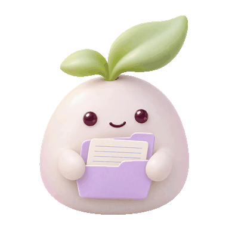
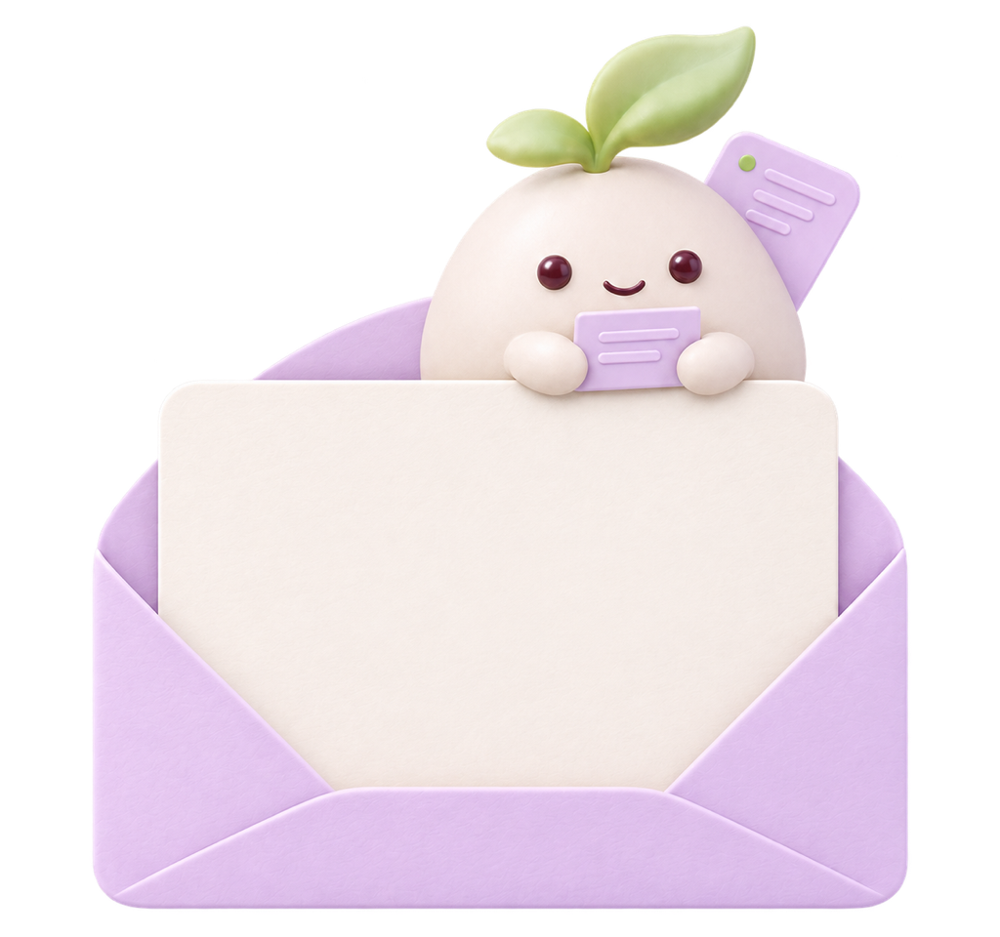
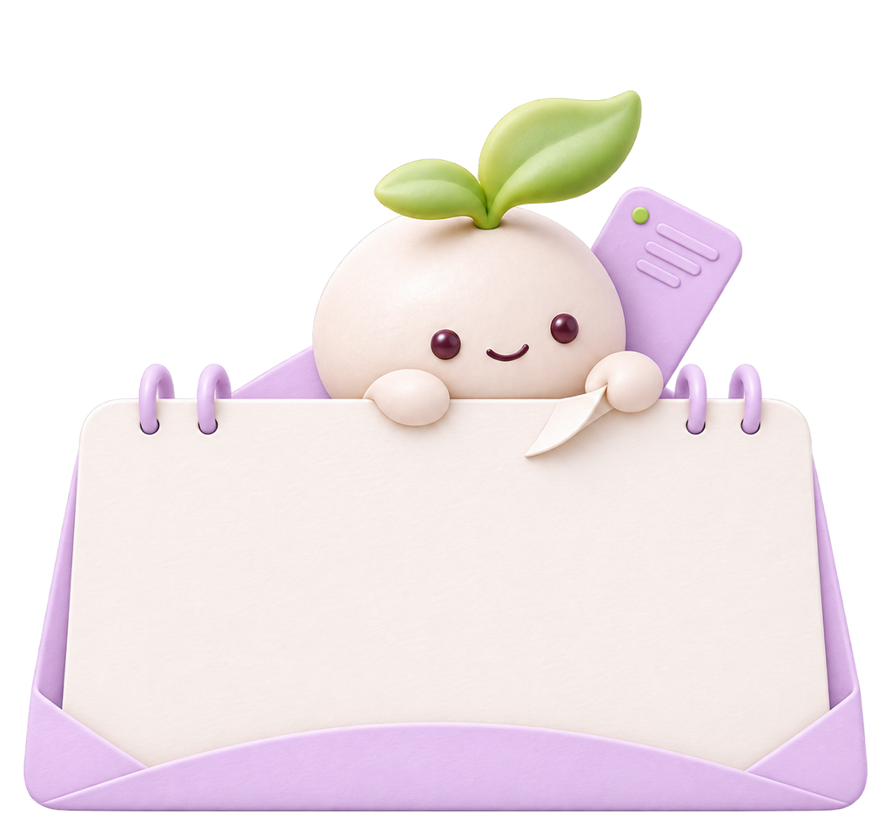
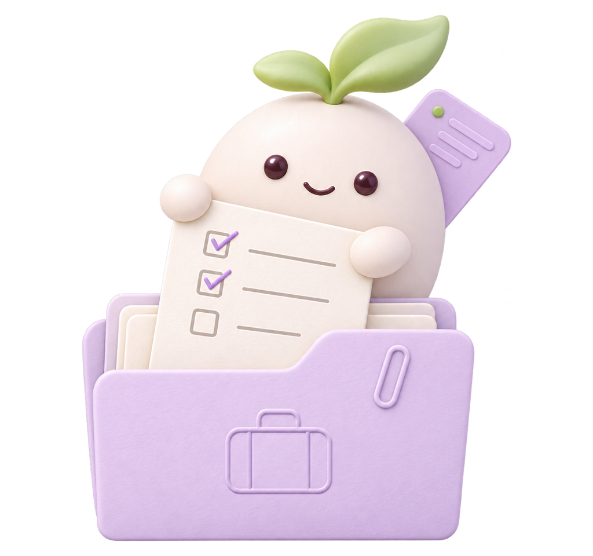
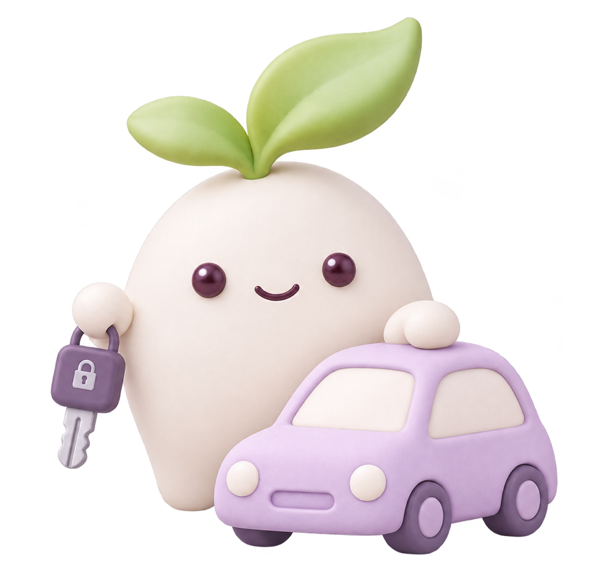
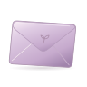
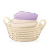
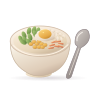

# 모리 에셋

[최종 화면 시안 ZIP](../../docs/screenshots/mori-soft-glass-pages.zip)에는 개별 화면 58장, 과정·확대 이미지 20장과 화면 안내가 있습니다. 이 폴더의 [미리보기](index.html)를 브라우저에서 열면 GIF를 재생하고, 배경을 바꾸고, 카드의 원본 PNG와 SVG를 나란히 비교할 수 있습니다. 인터넷 연결 없이도 열립니다.

## 대화 속 모리

| 부탁 접수 | 답변 대기 | 파일 전달 |
| :---: | :---: | :---: |
|  |  |  |
| [정지 PNG](characters/accept-request.png) · [GIF](characters/accept-request.gif) | [정지 PNG](characters/await-reply.png) · [GIF](characters/await-reply.gif) | [정지 PNG](characters/deliver-file.png) · [GIF](characters/deliver-file.gif) |
| 3.36초 · 42프레임 | 3.84초 · 48프레임 | 3.20초 · 40프레임 |

세 상태는 시안의 투명 캐릭터 원본을 움직여 만들었습니다. 정지 PNG는 768×768, 반복 GIF는 384×384이며 같은 위치에 겹쳐 교체할 수 있습니다. 미리보기는 기기의 동작 줄이기 설정에 따라 정지 PNG를 먼저 표시합니다.

## 탭별 일러스트

| 오늘 | 일정 | 보관함 | 생활 |
| :---: | :---: | :---: | :---: |
|  |  |  |  |

네 장 모두 1024×960 투명 PNG입니다. 오늘 탭의 질문과 일정 탭의 날짜는 비어 있는 편지지와 달력 위에 앱 텍스트로 얹을 수 있습니다. 생활 탭은 주차 위치를 보여주는 예시입니다.

탭별 일러스트는 각 탭의 시안을 참조해 내장 ImageGen으로 분리했습니다. 생성 시에는 원래 모리의 표정과 소품의 윤곽·광원·비율을 유지하고, 화면 글자와 배경을 지우며, 편지와 달력은 빈 종이로 남기도록 지정했습니다. 네 이미지를 같은 바닥선에 맞췄습니다.

## 아이콘

| 위치 | 파일과 용도 |
| --- | --- |
| [하단 탭](icons/tabs/) | 오늘·일정·보관함·생활의 기본 및 선택 상태. 기본 파일과 이름 끝에 `-active.svg`가 붙은 파일이 한 쌍입니다. |
| [조작](icons/actions/) | 시안에서 사용한 입력·음성·첨부·전송·탐색 등의 24×24 SVG. |
| [카드 SVG](icons/objects/) | 차량, 알림, 메모, 파일 등 12종. 크기를 바꿔 쓸 수 있는 경로와 그라데이션으로 그렸습니다. |
| [카드 원본 PNG](icons/originals/) | 화면 시안에서 사용한 512×512 일러스트 12장. 같은 이름의 SVG와 비교할 수 있습니다. |

| 알림 | 일정 | 차량 | 새 부탁 | 파일 | 생활 |
| :---: | :---: | :---: | :---: | :---: | :---: |
|  |  |  |  |  |  |

| 식사 | 메모 | 뉴스 | 반복 부탁 | 주가 | 여행 |
| :---: | :---: | :---: | :---: | :---: | :---: |
|  |  |  |  |  |  |

## 화면 시안

[오늘](reference/01-home.jpg) · [일정](reference/10-week.jpg) · [보관함](reference/15-library.jpg) · [생활](reference/20-life.jpg) · [부탁 접수](reference/04-working.jpg) · [답변 대기](reference/05-question.jpg) · [파일 전달](reference/07-file-ready.jpg)
