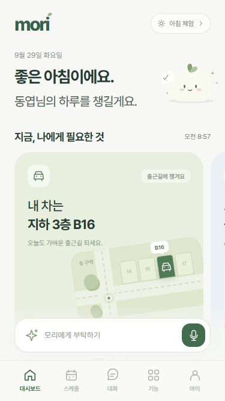

# 기능 기반 앱 PoC — 2026-09-29

기준: plan 브랜치 `product/feature-dashboard-scenario-2026-09-29.md`. 앱 화면 체험과 실제 Hermes 운영 상태를 구분합니다.

## 화면

2026-10-13: [아이폰 앱의 화면 구성과 상호작용을 참고한 UI/UX 개편](ios-experience-refresh.md)을 적용했습니다. 아래의 초기 화면 설명과 캡처는 이전 버전이며, 최신 캡처·변경 범위·검증 결과는 개편 문서를 참고하세요.

세이지·크림, 큰 제목, 여백, 얇은 아이콘, 5개 탭, 카드 캐러셀과 하단 시트. 로컬 Pretendard와 기존 모리 마스코트를 유지합니다. 음성은 진행 중인 대화로 이어집니다. OS의 움직임 줄이기를 지원합니다.

## 시나리오

| 시나리오 | 체험 방법 | 결과 |
| --- | --- | --- |
| 주차 | 대화에 지하 3층 B16에 주차했어 → 결과 → 새 위치 | 최신 위치로 교체, 설정한 출근 전 간격에 카드 표시, 중지/재개, 푸시와 별도 |
| 뉴스 | 하루 미리보기 브리핑 09:00 / 기능 뉴스 | 수집 중→완료, 기준 시각·예시 출처, 실패→재시도 |
| 주가 | 기능→관심 주가→종목/기간 선택 | 그래프·라벨·통화 변경, 예시 시세 |
| 메모 | 우산 챙기기 메모해줘 / 직접 제목만 입력 | 대시보드 기록과 같은 메모, 편집/삭제 |
| 스케줄 | 내일 오후 2시 디자인 미팅 일정 추가해줘 | 월/주/일과 같은 일정, 직접 CRUD |
| 알림 | 음성 예시 30분 뒤 알림→대화로 이어가기 | 현재 대화에서만 상세 자동 열기, 초 단위 카운트다운, +5분/취소 |
| 커스텀 | 가이드 마지막 예시→결과→지금 실행 | 정의·버전, 오늘 메모 체크리스트, 편집/중지/재개 |
| 시간 없는 기능 | 시간 없이 저장 후 실행 | 대시보드 기록과 정리에 결과 표시 |
| 문서 | 문서 정리→예시 또는 TXT/MD/CSV | 실제 내용 읽기, 번호 목록+원문 TXT 생성 및 다운로드 요청 |
| 대화 유지 | 텍스트→음성 예시→수정→전송 | 같은 대화에 추가, 검색, 새로고침 후 복원 |
| 마이 | 로그인·사용자 정보·이름 수정·테마·요금제 | 계정 API 연결, 테마 저장, 결제 준비 상태 안내 |

커스텀의 이름·설명·시간·참고 내용·작업은 선택적으로 입력합니다. 작업 없는 정의는 초안이며 실행을 비활성화합니다. 공통 상세 템플릿을 사용하고 임의 UI 코드를 생성하지 않습니다. 일반 인사는 기능을 만들지 않습니다.

## 실행 모델

- 하나의 로컬 상태를 화면/대화/결과에서 공유하며 `mori.experience.v6`에 보관합니다.
- 체험 시각은 실제 경과 시간에 따라 흐르고 미리보기로 이동합니다. 시간 이동은 기록을 지우지 않습니다.
- 알림은 목표 timestamp를 저장합니다. 다른 대화나 화면으로 이동한 뒤에는 상세를 자동으로 열지 않습니다.
- 예약은 날짜+시간으로 중복을 막고 평일/1회를 구분합니다. 앱이 닫힌 동안 실제 실행을 보장하지 않습니다. 재접속 시 당일 미실행 항목을 보정합니다.
- 응답 대기 중 대화를 바꿔도 원래 대화에 기록합니다. 초기화 후에는 이전 응답을 버립니다.
- 커스텀 실행은 오늘 저장한 메모 제목을 체크리스트로 만드는 예시입니다. 임의 작업의 실제 AI 실행은 연결 전입니다.
- 뉴스와 주가는 예시 표시를 유지합니다. 기사 상세 출처도 예시입니다.
- 실제 계정은 기존 BFF를 사용합니다. 최신 주차 GET은 `/api/parking/latest`, 저장은 `/api/parking`와 idempotency key입니다.

## 검증

- build/check/test 통과, 36개 테스트.
- 새 테스트: 일반 대화의 기능 미생성, 최신 주차와 카드 표시 간격/중지, 현재 카드, 알림 시각 유지, 메모/일정 요청, 커스텀 중복 방지/중지, 예약 중복 방지/뉴스 상태 전이.
- 브라우저: 주차→메모→음성 예시→알림을 같은 대화로 실행, +5분/취소 확인.
- 커스텀 생성/실행/중지/편집과 버전 변경, 새로고침 후 기록 유지 확인.
- 대화 및 직접 일정 저장, 주간/일간 전환 확인.
- 뉴스 실패/재수집/완료, 애플 USD와 주간 그래프 전환 확인.
- 실제 문서 내용/원문 결과 생성 및 다운로드 요청 확인. 인앱 브라우저의 다운로드 이벤트 대기가 시간 초과하여 OS 파일 저장 완료는 검증하지 못했습니다.
- 390×844 폰 세로, 844×390 폰 가로, 768×1024 태블릿 세로, 1024×768 태블릿 가로 확인. 페이지 가로 넘침 없음. 검증 중 콘솔 오류 없음.
- 작은 폰 기준으로 320×568 세로, 375×667 세로, 568×320 가로를 다시 확인. 5개 탭, 대화창, 음성 입력, 주차·뉴스·알림·문서·커스텀 상세, 하루 미리보기, 일정 입력, 요금제 선택에서 가로 넘침과 버튼 접근성을 확인했습니다.
- 320px 폭에서 하루 미리보기 카드의 글자 쪼개짐, 일정 날짜·시간 입력의 가로 넘침, 주차 지도와 위치 번호의 겹침, 요금제 카드 줄바꿈을 수정했습니다. 작은 폰 높이에서는 음성 전송 버튼이 보이게 조정했고, 가로 화면에는 음성 입력을 두 열로 배치했습니다.
- 대시보드 외 탭의 과도한 하단 빈 공간과 대화 목록 마스코트 잘림을 줄였습니다. 화면 갱신 시 현재 스크롤과 카드 위치를 보존합니다. 위 미리보기 이미지는 375×667 모바일 화면입니다.
- 실제 마이크 녹음, 소셜 실계정, GPU/Hermes, OS 푸시, Excel/PDF 처리는 이번 UI 검증 범위 밖입니다.

## 2026-09-30 UI/UX 정리

- 캘린더의 월·주·일 화면을 구분했습니다. 월은 날짜 선택과 선택일의 일정 카드, 주는 날짜별 묶음, 일은 시간대별 목록입니다. 800px 이상 월 보기에서는 달력과 일정 목록을 나란히 보여줍니다.
- 일정 종류(일·업무 / 약속 / 나의 시간)별 색상, 오늘 표시, 다음 일정, 날짜별 일정 개수, 연도·월 바로 이동을 제공합니다. 날짜 키보드는 방향키, Home/End, PageUp/PageDown을 지원합니다.
- 일정 폼에 소요 시간·종류·메모를 추가했습니다. 기존 데이터에는 기본 60분을 적용하며, 저장 전 종료 시각과 겹치는 약속을 안내합니다. 새벽·야간 일정 및 다음 날까지 이어지는 일정을 누락하지 않습니다. 삭제 후 9초 동안 되돌릴 수 있습니다.
- 기본 select를 공통 선택 필드로 교체했습니다. 반복, 주차 카드 표시 간격, 일정 종류·소요 시간은 동일한 선택 상태와 목록을 사용합니다. 방향키·Enter·Escape·Tab, 목록 밖 클릭을 지원하고 폼 스크롤 안에서 열려 작은 화면에서도 잘리지 않습니다.
- 섹션 간격, 카드 안쪽 여백, 입력 높이, 모서리 반경을 정리했습니다. 작은 보조 글자의 크기와 대비를 높이고, 일정 목록 등장·카드 호버·선택 상태에 전환 효과를 적용했습니다. 기존 움직임 줄이기 설정을 따릅니다.
- 날짜 계산은 `src/calendar-model.mjs`, 공통 선택 UI는 `src/choice-field.mjs`에서 관리합니다. HTML / JavaScript / SCSS 구성과 기존 실제 계정·주차 API 경로는 유지합니다.
- 이 변경은 PoC의 로컬 화면·데이터 동작입니다. Hermes 채팅, 실제 캘린더 API, 서버 예약·푸시 연결을 추가한 것은 아닙니다.

검증: SCSS 빌드, JavaScript 구문 검사, 테스트 41개(달력 날짜 경계·누락·시간 겹침 포함). 브라우저에서 일정 생성/편집/새로고침 후 유지, 선택 필드 키보드 조작, 자정 이후 표시, 삭제/되돌리기를 확인했습니다.

## 2026-09-30 스케줄 외 영역 고도화

- **대시보드:** 메모 버튼은 직접 작성 폼을 엽니다. 메모·문서·내 기능의 실행 결과를 최근 순서로 합쳐 3개만 보여주고, 전체 기록은 종류별 필터가 있는 보관함에서 확인합니다. 주차 그림의 가상 구역/자리 번호를 제거하고 위치 메모임을 구분했습니다. 내 기능의 카드는 저녁에 한정된 표현 대신 요청과 결과 상태를 보여줍니다. 뉴스 카드는 관심 주제와 준비 상태를 반영합니다.
- **대화:** 고정/오늘/어제/이전 대화로 묶고 제목과 본문을 검색합니다. 검색 결과가 없는 상태를 별도로 안내합니다. 대화 상단의 정리 버튼에서 이름 변경과 고정/해제를 지원합니다. 새로운 대화와 각 기존 대화의 초안을 따로 보관하고 새로고침 뒤에도 복원합니다. 예시 요청은 바로 실행하지 않고 입력란에 채워 확인 후 전송하도록 했습니다. 결과 링크를 구별되는 카드로 표현하고 읽고 있는 중에는 새 응답으로 스크롤을 강제로 내리지 않습니다.
- **음성:** 음성 창을 오가도 키보드 초안을 유지합니다. `채팅에 담기`는 기존 문장 뒤에 음성 내용을 붙이며, 사용자가 확인 후 보냅니다. 합산 4,000자 제한과 빈 메시지 전송 방지를 적용했습니다. 음성 오브·녹음 상태·버튼 대비를 정돈했습니다. 실제 마이크 권한과 음성 인식은 브라우저 환경에 따라 다르며 검증에서는 음성 예시를 사용했습니다.
- **기능:** 기본 카드에 현재 주차·메모 개수·브리핑 시간·관심 종목·알림 개수를 표시합니다. 내 기능에 사용 상태와 최근 결과를 표시하며, 만들기/편집 폼은 카드 미리보기, 6개 기본 아이콘, 선택형 참고 자료를 제공합니다. 미리보기와 저장 시 시간/반복의 기본값은 같습니다. 온라인 아이콘 검색과 실제 스킬 생성은 구현 범위가 아닙니다.
- **상세 화면:** 뉴스 상태 전환과 알림 완료 시뮬레이션을 접힌 체험 옵션으로 옮겼습니다. 메모 삭제 후 되돌리기, 문서의 정리 목록/원문 펼치기, 주차 긴 위치명 줄바꿈을 보완했습니다. 새 문서는 원문 앞부분을 목록으로 옮기는 로컬 처리이며 실제 AI 요약으로 표시하지 않습니다. 기존 형식으로 저장된 문서는 그대로 열립니다.
- **마이:** 프로필·기록/대화/기능 개수·플랜 체험·개인 설정·실제 계정 연결을 구분했습니다. 설정마다 적용 범위를 설명하고 초기화는 기록 관리 하위에 배치했습니다. Free/Pro 표시는 체험이며 실제 계정 권한이나 결제 상태를 바꾸지 않습니다.
- 카드·입력·버튼 간격, 작은 글자 대비, 빈 상태, 키보드 포커스와 전환 애니메이션을 정리했습니다. 기존 움직임 줄이기 설정을 따릅니다. 스케줄 모델과 월·주·일 화면의 동작은 이번 추가 작업에서 변경하지 않았습니다.

검증: 구문 검사와 44개 테스트 통과(통합 기록 정렬/필터, 고정 대화 및 월말 날짜 그룹, 미리보기 기본값 포함). 별도 로컬 포트에서 메모 저장/삭제/복원, 문서 정리/원문, 기능 아이콘 저장/실행/보관함 연결, 뉴스 실패/재시도, 채팅 초안 복원과 음성 전환을 확인했습니다. 이 변경은 HTML/JavaScript/SCSS PoC이며 실제 Hermes·검색·푸시·소셜 로그인 서버 통합 검증을 의미하지 않습니다.

## 2026-09-30 대시보드 시간 범위 탐색

- `지금, 나에게 필요한 것` 우측 시간 버튼으로 **지금 / 3시간 / 5시간 / 하루**를 선택합니다. 하루는 오늘 자정까지가 아니라 **현재부터 24시간**입니다. 선택은 탭 이동 중 유지되며 새로고침 시 `지금`으로 돌아옵니다.
- `지금`은 기존 현재 카드 캐러셀을 유지합니다. 범위를 넓히면 **지금 확인할 카드 → 오늘 아침/오후/저녁 → 내일 새벽/아침**처럼 해당 범위에 실제 항목이 있는 시간대별 가로 목록을 만듭니다. 터치 스크롤, 좌우 버튼, 카드의 방향키/Home/End 탐색을 지원합니다.
- 주차/주가의 카드 표시 시각, 뉴스 수집 시작, 개별 약속, 알림 목표 시각, 내 기능의 실행 시각을 구분해 표시합니다. 카드에는 시각·현재/예정 상태·기능명·설명이 있고, 선택하면 기존 상세 화면을 엽니다. 미래에 실행될 결과를 미리 생성하거나 성공한 것처럼 표시하지 않습니다.
- 미리보기 계산은 `src/dashboard-timeline.mjs`에서 순수하게 수행합니다. 체험 시간을 바꾸거나 예약 실행·데이터 저장을 호출하지 않습니다. 시간 범위는 시작을 포함하고 끝 시각은 제외합니다. 이미 표시 중인 카드는 `지금 확인` 묶음에 포함됩니다.
- 날짜 경계, 종료된 약속, 다음 날 반복, 평일 반복, 중지/취소/실행 완료된 한 번 예약, 시간이 없는 기능을 구분합니다. 주차/뉴스/주가의 반복 정책은 기존 PoC 정의를 따릅니다. 실제 서버 스케줄 조회는 추가하지 않았습니다.
- 작은 화면에서 펼침 메뉴가 하단 입력창에 가려지면 화면 안쪽으로 옮겨 표시합니다. Escape·바깥 클릭·키보드 선택, 가로 목록 위치 유지, 움직임 줄이기 설정을 지원합니다.

검증: 전체 테스트 50개 통과. 3/5/24시간 포함 범위, 자정과 월말, 실행 없는 읽기 계산, 반복 중복 방지, 취소/중지 및 1회 예약을 검사했습니다. 브라우저에서 범위 전환·가로 넘김·키보드·모바일 메뉴 표시를 확인했습니다.

## 2026-09-30 마이 · 계정 설정 정리

- 마이는 로그인·로그아웃, 사용자 정보 조회·이름 수정, 시스템/라이트/다크 테마, 요금제·결제 관리로 정리했습니다. 위의 초기 마이 검증 기록은 이전 화면이며 현재는 출근 시간, 대시보드 토글, 기록 수, 체험 시간, 기록 초기화, 가짜 Free/Pro 전환을 마이에서 제공하지 않습니다.
- 로그인한 계정의 이름·테마는 실제 API에 저장합니다. 동시에 수정하면 revision 충돌을 안내합니다. 테마는 로그인 전에는 브라우저에만 저장되며, 움직임 줄이기는 OS 설정을 따릅니다.
- 로그인·로그아웃은 기존 네이버/카카오 인증을 사용하고, 토큰은 서버 세션에만 보관합니다. 소셜 키가 없는 공급자는 로그인 버튼을 비활성화합니다.
- 무료 이용은 결제가 필요 없습니다. Pro 결제·해지는 결제사, 가격, 주기가 확정되지 않아 준비 중이며 결제 성공을 흉내 내지 않습니다. 기존 관리자 승인 Pro는 결제 구독과 구분합니다.
- 백엔드는 `GET/PATCH /v1/me`, `GET/PUT /v1/me/settings`, `GET /v1/plans`, `GET /v1/me/subscription`을 사용합니다. `/me/preferences`, `/me/summary`는 제거했습니다. `0006_account_settings` 적용이 필요합니다.
- 다른 탭의 대화·일정·기록 등은 기존 로컬 PoC 데이터이며 이번 변경이 전체 기능의 서버 연동을 의미하지 않습니다.

검증: PoC 테스트 51개, 백엔드 테스트 185개 통과. 인증·소유권·수정 충돌, 허용된 BFF 경로와 요청 출처 검증을 확인했습니다. 브라우저에서는 마이 화면, 모바일 배치, 테마 전환·새로고침 유지, 결제 준비 상태를 확인했습니다. 실제 소셜 로그인은 공급자 키와 콜백 설정 후 확인해야 합니다.

## 2026-10-02 주차·문서 UI 보완

- 백엔드 0.7.0에 맞춰 주차 용도(출근용/외부)와 표시 방식(상시/정한 시간)을 선택하는 폼을 추가했습니다. 지정 시간일 때만 시각·요일·표시 기간을 펼치며 저장할 위치와 표시 방식을 미리 보여줍니다.
- 단순 위치 기억은 상시 표시하고, 출근 표시 요청은 기존 체험 문맥을 사용합니다. 상시 카드는 하루 범위에서도 하나만 표시합니다. 주차 일시중지 버튼은 제거했고 기존 기록은 초기화하지 않습니다.
- 문서는 UTF-8 10,000,000바이트까지 지원하며 IndexedDB에 원문 하나를 보관합니다. 목록에는 메타데이터만 저장하고 상세 미리보기는 12,000자로 제한합니다. 파일명·용량·원문 보관 상태와 원문 다운로드 버튼을 제공합니다. 기존 문서 형식도 읽습니다.
- 320×568, 375×667 모바일에서 주차 선택과 문서 상세 배치를 확인했고 가로 넘침이 없었습니다. 320px의 시간 입력은 한 열로 배치했습니다. 실제 10MB 파일을 선택해 저장하고 새로고침 후 원문 앞부분과 용량을 다시 확인했습니다.
- 구문 검사·CSS 빌드·자동 테스트 56개 통과. 브라우저 다운로드 완료 이벤트는 확인하지 못했으며 다운로드 버튼/원문 읽기 경로와 기존 파일 복원은 검증했습니다.
- 로컬 PoC 경험의 변경입니다. 운영 서버 배포·전체 화면 API 연결·실제 Hermes/GPU·기기 푸시·Office 변환은 수행하지 않았습니다.

대시보드·상세 전환·음성 입력 후속 개선: [상호작용 보완 기록](ios-interaction-refinement.md).

모바일·태블릿별 탐색과 화면 배치: [반응형 앱 구성 및 검증 기록](mobile-tablet-experience.md).

## 2026-10-13 실제 앱 화면을 참고한 시각 정리

참고 화면은 [Structured의 App Store 스크린샷](https://apps.apple.com/us/app/structured-daily-planner-todo/id1499198946)과 [Apple 미리 알림의 생성 화면](https://support.apple.com/en-us/102484)이다. 전자는 시간과 작업 내용의 위계를, 후자는 묶인 목록과 간결한 입력 화면을 참고했다. 타사 로고나 앱 이미지는 모리 화면에 사용하지 않았다.

- 대시보드는 날짜·시간 범위·계정 버튼만 헤더에 남긴다. 주차의 위치 값은 짙은 녹색 카드로 강조하고, 뉴스·주가·일정은 흰 바탕과 작은 기능 색상으로 구별한다. 기사 제목과 저장 위치 등 실제 내용을 먼저 보여주며 체험 데이터 표시는 유지한다.
- 최근 기록은 색이 다른 큰 타일 대신 메모·문서·실행 결과가 함께 들어가는 목록으로 바꾼다. 저장 일자, 제목, 본문 일부가 같은 위치에 표시되고 기존 상세 화면으로 연결된다.
- 휴대폰과 세로 태블릿에는 둥근 반투명 하단 탭을 사용한다. 채팅·음성 입력 버튼은 모두 52px 높이이며, 가로 태블릿은 기존 좌측 탐색을 유지한다. 빠른 기록 버튼의 별도 상자를 없애고 아이콘과 짧은 동작명으로 통일했다.
- 대화는 상단 작성 버튼, 검색, 음성 시작, 대화 목록으로 정리했다. 새 메시지 초안 이어쓰기와 대화별 초안은 유지한다. 기능 탭의 큰 안내 배너·중복 만들기 패널을 제거하고, 사용 안내 행과 기능별 현재 상태를 표시한다. 마이의 요금제 진입점도 한 곳으로 합쳤다.
- 채팅은 흰 읽기 화면과 간결한 요청 예시 목록으로 바꿨다. 음성 패널과 키보드 사이의 전환, 전송 전 내용 확인은 유지한다. 메뉴에는 짧은 펼침 전환을 적용했으며 OS의 움직임 줄이기 설정을 따른다.
- 주차 카드와 상세 화면은 같은 배경·공유 요소를 사용한다. 주차 도형의 기울기를 제거하고 크기를 동일하게 맞춰 전환 중 갑자기 커지지 않게 했다. 짧은 휴대폰에서는 글자·그래프·기사 간격을 함께 줄여 카드 하단 문구와 겹치지 않도록 했다.

검증: CSS 빌드·구문 검사, 기존 64개 테스트 통과. 320px와 820px에서 5개 탭의 가로 넘침 없음, 390px에서 입력/마이크 버튼 높이 52px 일치, 320×568 뉴스 카드의 본문과 하단 영역 비중첩을 확인했다. 주차 상세 열기/닫기, 대화→음성→키보드 복귀, 라이트/다크 전환을 브라우저에서 확인했다. 크기별 일부 검증에는 같은 출처의 iframe을 사용했고 검사 파일은 제거했다. 실제 iPhone/iPad의 Safari, 소프트 키보드, 마이크 인식은 별도 기기 검증이 필요하다. 서버 기능이나 실제 AI 연동 범위는 변경하지 않았다.

화면 기록: [모바일 대시보드](screenshots/native-refinement/dashboard-mobile.png), [태블릿 대시보드](screenshots/native-refinement/dashboard-tablet.png), [기능 목록](screenshots/native-refinement/features-mobile.png), [채팅](screenshots/native-refinement/chat-mobile.png).

## 2026-10-13 헤더·목록·전환 후속 보완

첨부 화면에서 최근 기록의 마지막 행 배경이 안쪽에서 잘려 보이는 문제를 수정했다. 컨테이너의 좌우 패딩을 행으로 옮겨 터치 영역과 배경을 카드 끝까지 연결했고, 구분선만 텍스트 시작점에 맞췄다. 전역 버튼 축소 효과가 행의 `transform: none`보다 우선하던 충돌도 제거했다. 마이·대화·기능의 공통 목록에도 같은 간격 규칙을 적용했다.

- 상단은 왼쪽 모리 마스코트·워드마크와 오른쪽 계정 이름으로 분리한다. 이름은 인증된 세션의 `display_name`만 사용하고 비로그인 상태에서는 로그인 진입점을 표시한다. 긴 이름은 말줄임하며 전체 이름은 접근성 이름으로 남긴다. 넓은 창의 대시보드에서는 사이드바 로고를 중복 표시하지 않는다.
- 날짜와 현재 시각/시간 범위 선택은 카드 바로 위에 함께 배치한다. 기존 지금·3시간·5시간·하루 보기를 유지한다.
- 최근 기록은 제목과 날짜를 첫 줄, 본문 일부를 다음 줄에 배치한다. 본문은 최대 두 줄이며 원문은 상세에서 읽는다. 종류는 아이콘과 접근성 텍스트로 구분한다. 제목 16px/600, 본문 14px/400, 날짜 12px/400으로 위계를 맞췄다.
- 주차·커스텀 기능·테마의 문구를 저장, 주차 용도, 대시보드 표시, 작업 내용 등 실제 행동과 설정 이름으로 바꿨다. 저장된 사용자 기록과 대화 원문은 변경하지 않았다.
- 다섯 탭과 시간 범위 전환은 좌우 이동 없이 150ms 페이드로 처리한다. 상세 안의 앞/뒤 이동은 방향을 유지하며 주차 카드의 공유 요소 전환과 중간 취소, 닫기 후 포커스 복원은 유지한다. 움직임 줄이기 설정에서는 전환을 생략한다.

시각 참고는 공식 공개 화면을 직접 열어 확인했다. 실제 기기에 모든 앱을 설치하거나 모든 화면을 확인한 것은 아니다.

| 참고 | 반영한 원칙 |
| --- | --- |
| [ChatGPT 공식 화면](https://apps.apple.com/us/app/chatgpt/id6448311069), [Gemini 공식 화면](https://apps.apple.com/us/app/google-gemini/id6477489729) | 입력과 음성 도구를 구분하고 대화 본문을 우선한다. |
| [토스 공식 화면](https://apps.apple.com/kr/app/%ED%86%A0%EC%8A%A4/id839333328), [당근 공식 화면](https://apps.apple.com/kr/app/%EB%8B%B9%EA%B7%BC/id1018769995) | 한글 제목과 보조 정보의 차이, 짧은 동작명, 일정한 목록 간격을 사용한다. |
| [Muse로 알려진 캔버스 앱의 현재 Allume 공개 화면](https://apps.apple.com/br/app/allume-for-focused-thinking/id1501563902) | 기록 내용과 도구를 구획하고 불필요한 안내를 줄인다. 사용자가 말한 Muse와 동일 앱인지는 확인되지 않았다. |
| [Apple Motion HIG](https://developer.apple.com/design/human-interface-guidelines/motion) | 같은 단계의 이동과 상세 진입을 구분하고, 동작 중 취소와 움직임 줄이기를 지원한다. |

검증: CSS 빌드·구문 검사·자동 테스트 67개 통과. 같은 출처의 iframe에서 320×568 및 820×1180 다섯 탭의 가로 넘침이 없음을 확인했다. 390×844에서 헤더, 최근 기록의 전체 폭 배경과 구분선, 계정 진입, 3시간 보기, 주차/메모 상세 열기·닫기, 음성→키보드 전환, 라이트/다크 화면을 확인했다. 인증 사용자 이름 표시는 실제 OAuth 로그인으로 검증하지 않았다. 실제 iPhone/iPad의 터치·소프트 키보드·VoiceOver는 후속 기기 검증 대상이다.

화면 기록: [모바일 헤더](screenshots/header-list-refinement/mobile.png), [최근 기록](screenshots/header-list-refinement/records.png), [태블릿](screenshots/header-list-refinement/tablet.png).

## 2026-10-13 대화·기능·마이 및 상세 화면 통일

- 대화는 검색과 새 대화, 음성 시작을 분리하고 제목·미리보기·날짜의 정렬과 글자 크기를 맞췄다. 채팅 본문은 14px/1.75, 입력 글자는 16px로 읽기와 입력을 구분했다.
- 기능 탭은 기본 기능과 사용자 기능을 같은 목록 간격으로 보여준다. 사용 예시는 목록 뒤로 옮겼다. 제목은 28px, 상세 제목은 24px, 목록 제목은 16px, 본문은 14px, 날짜와 보조 정보는 12px를 기준으로 삼는다.
- 마이는 계정 카드, 내 정보·이름 변경, 테마, 요금제 및 결제로 묶었다. 인증된 계정 정보와 로그인 진입은 기존 API 동작을 유지한다.
- 뉴스·주가·일정·알림·사용자 기능 상세에 공통 헤더와 여백을 적용했다. 뉴스의 중복 출처 예시 문구, 사용자 기능의 반복 안내를 줄이고 작업·일정·결과 순서로 배치했다. 메모·문서·편집 폼·테마 선택에도 같은 글자와 버튼 규격을 적용했다. 주차의 기존 공유 카드 전환은 유지한다.
- 새로 시작하는 체험의 기본 메모·대화 제목과 응답을 구체적인 요청 내용으로 바꿨다. 이미 저장된 사용자의 기록과 대화 원문은 덮어쓰지 않는다.
- 상세 안에서 체크·주가 기간 등 상태만 바꿀 때는 스크롤과 버튼 포커스를 유지하고 슬라이드하지 않는다. 상세 진입과 뒤로가기는 기존 방향 전환을 유지한다. 사용자 정보 수정의 뒤로가기, 비동기 문서 로딩 뒤 상세 식별자, 가이드에서 시작한 대화의 복귀 대상도 보완했다.

검증: CSS 빌드·구문 검사와 자동 테스트 71개 통과. 같은 출처 iframe에서 320×568, 390×844, 820×1180 크기를 점검했고 대화·기능·마이의 가로 넘침이 없었다. 뉴스→기사→뒤로, 주가 상세, 알림 목록, 메모 상세, 사용자 기능→편집→뒤로, 테마 선택과 라이트/다크 화면을 확인했다. 사용자 기능 체크는 두 번 눌러 원래 상태로 복원했고, 갱신 전후 스크롤 207.5px와 해당 버튼 포커스가 유지됐다. 원래 라이트 테마로 돌려놓았다.

한계: 실제 소셜 로그인 상태의 사용자 정보 수정, 원문을 가진 문서의 비동기 표시, 가이드 요청 실행 후 대화 복귀는 이번 브라우저 점검에서 실행하지 않았다. 복귀 대상 선택은 새 단위 테스트로 검증했다. 실제 iPhone/iPad의 Safari·터치·소프트 키보드·VoiceOver는 별도 기기 검증 대상이다. 전체 API 연결이나 실제 AI·결제·기기 푸시 범위는 변경하지 않았다.

화면 기록: [기능](screenshots/secondary-refinement/features-mobile.png), [대화](screenshots/secondary-refinement/conversations-mobile.png), [마이](screenshots/secondary-refinement/my-mobile.png), [뉴스 상세](screenshots/secondary-refinement/news-mobile.png), [다크 상세](screenshots/secondary-refinement/news-dark-mobile.png), [태블릿](screenshots/secondary-refinement/features-tablet.png).

## 2026-10-13 탭 상단 내비게이션 정리

큰 화면 제목 자체가 잘못된 패턴은 아니다. [Apple UIKit 문서](https://developer.apple.com/documentation/uikit/uinavigationbar/preferslargetitles)는 큰 제목과 작은 제목을 모두 지원한다. 다만 모리에서는 큰 탭 제목, 요약 배너, 보기 전환, 월 제목이 연달아 쌓여 실제 달력이 늦게 보였다.

공식 공개 화면을 직접 열어 비교했다. [Apple 캘린더 안내 화면](https://support.apple.com/en-nz/guide/iphone/iphfd1054569/ios)은 월·날짜와 검색·추가 도구를 강조한다. [카카오톡 App Store 화면](https://apps.apple.com/kr/app/%EC%B9%B4%EC%B9%B4%EC%98%A4%ED%86%A1-kakaotalk/id362057947)은 짧은 제목 옆에 검색·추가·설정 도구를 배치한다. 모든 앱에 동일한 제목 배치가 있다는 뜻은 아니며, 실제 기기에 앱을 설치해서 조사한 것은 아니다.

- 스케줄·대화·기능·마이는 56px 높이 상단 바, 가운데 17px 제목으로 통일했다. 오른쪽 동작은 44×44px 영역을 유지하되 흰 원형 배경과 그림자를 제거했다. 최상위 탭에 불필요한 뒤로가기 버튼을 넣지 않는다.
- 상단 바는 본문 스크롤 중에도 남는다. 화면 진입은 기존 페이드 전환과 움직임 줄이기 설정을 유지한다.
- 스케줄의 큰 요약 배너를 제거했다. 선택한 월·주·일의 일정 수는 달력의 월 제목 아래에 짧게 표시한다. 오늘 일정과 선택한 기간의 수치를 한 배너에 섞지 않는다. 월·주·일 전환, 날짜 선택, 일정 추가와 목록은 유지한다.
- 대시보드의 모리 로고·계정 이름 헤더와 각 기능 상세 화면의 뒤로가기 구조는 유지한다. 가운데 제목은 비교한 앱의 화면을 그대로 복제한 것이 아니라 모리의 작은 화면에 맞춘 선택이다.

검증: CSS 빌드·구문 검사·자동 테스트 71개 통과. 브라우저의 390×844 크기에서 네 탭의 상단과 일정 추가 폼 진입·닫기를 확인했다. 본문 스크롤 309px에서도 상단 바 위치가 유지됐다. 320×568에서 네 탭, 820×1180에서 스케줄·기능의 가로 넘침이 없었다. 실제 iPhone/iPad의 Safari·터치·안전 영역은 별도 기기 검증 대상이다.

화면 기록: [스케줄](screenshots/navigation-header/schedule-mobile.png), [대화](screenshots/navigation-header/conversations-mobile.png), [기능](screenshots/navigation-header/features-mobile.png), [마이](screenshots/navigation-header/my-mobile.png), [태블릿 스케줄](screenshots/navigation-header/schedule-tablet.png).

## 2026-10-13 taste 기준 UI/UX 점검과 보완

`design-taste-frontend`의 기존 화면 점검·브랜드 보존 원칙과 `redesign-existing-projects`의 앱 개선 절차로 검토했다. 모리는 모바일 개인 비서 앱이므로 랜딩 페이지용 대형 제목, 비대칭 그리드, 장식적 스크롤 효과는 적용 대상에서 제외했다. 기존 정보 구조, 라우트, 탭 이름, Pretendard, 마스코트와 녹색 강조색을 유지했다. 디자인 변화 수준은 3, 움직임은 4, 정보 밀도는 4로 잡고 필요한 조작 피드백과 기존 전환만 유지했다.

점검에서 확인한 문제와 수정:

| 문제 | 반영 |
| --- | --- |
| 긴 대화·메모·문서 본문이 미리보기와 같은 14px | 읽기 본문을 16px, 줄높이 1.75~1.8로 구분하고 긴 줄 폭을 제한했다. 목록 미리보기는 14px로 유지한다. |
| 보조 글자의 옅은 배경 대비 부족 | 보조 색상을 `#636b65`로 바꿨다. 다크 모드 주가 상승 값은 별도 밝은 색상으로 구분한다. 전체 접근성 인증을 의미하지 않는다. |
| 검색 아래 음성 링크가 별도 공간을 차지함 | 대화 검색과 48px 높이 음성 버튼을 한 줄에 배치했다. 검색 포커스를 외곽선으로 표시한다. 작성 중인 메시지는 별도로 이어쓸 수 있다. |
| 작은 상태·동작 표시 | 카드 상태, 사용자 기능 상태, 음성 동작명은 12px로 조정했다. 하단 탭 이름은 11px이며 버튼 터치 영역은 유지한다. |
| 비어 있는 달력의 큰 장식 카드 | 달력 아이콘, 안내, 일정 추가로 압축했다. 오늘 버튼은 44px 높이로 맞추고 일 보기의 일정 추가 문구는 호버 없이 표시한다. |
| 사용자 기능 카드의 긴 제목·설명 | 미리보기 줄 수를 제한하고 반복 안내를 감췄다. 짧은 화면에서는 보조 요약을 숨겨 하단 동작과의 겹침을 줄인다. 원문은 상세에서 확인한다. |
| 본문 바로가기가 대시보드로 이동 | 현재 해시를 유지하면서 본문에 포커스를 전달한다. |
| 탭 DOM 교체 시 키보드 포커스 소실 | 같은 탭의 새 버튼에 포커스를 복원한다. |
| 반복 녹음이 기존 내용을 덮어씀 | 녹음 시작 전의 내용을 유지하고 현재 녹음 결과만 뒤에 붙인다. 사용자가 직접 수정하면 진행 중 인식을 중단해 늦게 도착한 결과가 덮어쓰지 않게 했다. |
| 대화 전체 교체가 중복 낭독을 유발할 수 있음 | 읽는 대화 영역과 새 응답의 상태 알림 영역을 분리했다. 이전 대화를 다시 렌더링할 때 전체 기록을 알림으로 전달하지 않는다. |

검증: CSS 빌드·구문 검사·자동 테스트 75개 통과. 320×568, 820×1180에서 다섯 탭의 가로 넘침이 없었다. 390×844에서 대화 목록, 16px/28px 본문, 음성 입력 패널, 검색 포커스와 빈 결과, 일정 추가, 다크 주가 상세를 확인했다. 본문 바로가기 후 `#conversations`와 본문 포커스를 유지하고, 키보드로 기능 탭 전환 후 해당 탭 버튼에 포커스가 남는 것을 확인했다. 일간 09:00 추가 버튼은 폼에 09:00을 전달한다. 테마는 검증 후 라이트로 복원했다.

한계: 실제 마이크 인식과 VoiceOver 낭독은 실행하지 않았다. 음성 이어붙이기와 중간 인식 결과 처리는 단위 테스트로 확인했다. 임의의 긴 사용자 기능 데이터, 실기기 Safari·소프트 키보드·안전 영역은 후속 검증 대상이다. 앱 데이터와 실제 AI·결제 연결 범위는 변경하지 않았다.

화면 기록: [대화 목록](screenshots/taste-audit/conversations-mobile.png), [대화 본문](screenshots/taste-audit/chat-reading-mobile.png), [비어 있는 일정](screenshots/taste-audit/schedule-empty-mobile.png), [다크 주가 상세](screenshots/taste-audit/stock-dark-mobile.png), [태블릿 일정](screenshots/taste-audit/schedule-tablet.png).

## 2026-10-13 별도 시안 폐기 후 기존 앱 정리

사용자 요청에 따라 별도 `mori-ios-concept` 디렉터리와 4174 개발 서버를 제거했다. 기존 `poc`의 4173 앱에서 작업하며, 기존 미커밋 변경과 저장된 메모·대화는 보존했다.

`design-taste-frontend`는 랜딩 페이지 중심 스킬이며 밀도 높은 제품 UI와 네이티브 앱은 주 적용 범위가 아니다. 이번에는 진단·브랜드 보존·문구·타이포그래피 기준을 사용하고, 실제 앱 개선에는 `redesign-existing-projects`를 함께 적용했다. 방향은 변화 수준 4, 움직임 4, 정보 밀도 5다. 장식적인 새 레이아웃보다 현재 정보와 실행할 동작을 명확히 하는 데 집중했다.

- 대시보드: 카드 높이와 제목 위 여백을 줄였다. 뉴스의 주제명 대신 예시 기사 제목을 첫 정보로 보여준다. 중복 배지와 시세 안내를 정리하고 예시 데이터라는 표시는 유지한다. 빠른 기록은 같은 크기의 네 동작으로 정렬했다.
- 시간별 보기: 현재 상태를 중복 설명하던 문구와 배지를 제거했다. 예정된 동작은 계속 표시한다. 카드 높이와 아이콘을 줄이고 종목명을 직접 표시한다. 지금·3시간·5시간·하루의 범위 계산은 그대로다.
- 기록과 기능: 목록 여백, 구분선, 제목·보조 글자 크기를 맞췄다. 기본 기능과 내 기능은 의미 있는 목록 구조로 만들었다. 각 행은 기능 이름과 현재 값·예약 시간·실행 결과를 보여준다. 기존에 저장된 사용자 문구는 덮어쓰지 않는다.
- 상세: 주차장의 장식 그림과 반복된 표시 시간 안내를 제거했다. 본문에서 표시 방식·시간을 한 번씩 설명한다. 체크리스트를 변경하면 상세뿐 아니라 대시보드 완료 수도 바로 갱신한다.
- 음성: 무지개 빛과 별 모양 대신 모리 마스코트를 사용한다. 대기 상태에서는 움직이지 않고 실제 듣기 상태에서만 맥박과 파형이 나타난다. 문장을 확인한 뒤 대화 초안으로 넘기는 흐름은 유지한다.
- 전환: 중첩 상세를 닫으면 대화 안의 원래 버튼으로 초점이 돌아간다. 닫기 제스처 중 포인터가 취소되거나 움직임 줄이기 설정이 바뀌어도 임시 스타일이 남지 않게 했다. 등장 중 드래그를 시작할 때 화면이 갑자기 불투명해지는 현상도 수정했다.

검증: CSS 빌드, JavaScript 구문 검사, 자동 테스트 79개 통과. 브라우저에서 390×844 기능 목록·주차 상세/편집/복귀·대화 검색 빈 상태·시간 범위 선택·음성 텍스트의 대화 초안 전달을 확인했다. 320×740 대시보드와 음성 패널, 834×1112 기능 목록과 다크 대시보드를 확인했다. 320px와 834px에서 문서 가로 넘침이 없었고, 320px에서 채팅·마이크 버튼은 모두 52px 높이였다. 체크리스트 완료 수의 즉시 갱신을 확인한 뒤 체크 상태와 테마를 원래대로 되돌렸다.

실제 음성 인식, iPhone/iPad의 터치·Safari·VoiceOver 및 실제 서버 연동은 이번 검증 범위에 포함하지 않는다. 별도 배포와 Git 커밋·푸시는 수행하지 않았다.

화면 기록: [대시보드](screenshots/service-refinement/dashboard-after.png), [기능 목록](screenshots/service-refinement/features-after.png), [음성 입력](screenshots/service-refinement/voice-after.png), [시간별 보기](screenshots/service-refinement/forecast-after.png), [태블릿 기능](screenshots/service-refinement/features-tablet.png), [다크 대시보드](screenshots/service-refinement/dashboard-tablet-dark.png).

## 2026-10-13 대화·스케줄·마이 및 상세 사용 흐름 보완

기존 화면과 저장 데이터를 유지하면서 대시보드에서 정리한 글자 크기, 목록 간격, 짧은 동작명 기준을 나머지 화면에도 적용했다. 화면별 기능은 직접 눌러 확인하고, 비동기 응답 순서와 초안 보존은 별도 회귀 테스트로 보완했다.

- **대화:** 검색·새 대화·음성 입력의 역할을 유지한다. 입력 중에는 예시 버튼이 내용을 덮어쓰지 않고 먼저 보내거나 지우도록 안내한다. 사용 예시에서 요청을 실행해도 기존 초안을 보존한다. 상세를 닫으면 해당 대화의 결과 버튼으로, 대화 정리를 마치면 정리 버튼으로 초점이 돌아온다.
- **스케줄:** 달력 내부 간격을 줄이고, 주 보기에서 일정이 없는 날의 중복 빈 카드를 제거했다. 날짜와 추가 버튼은 남겨 바로 등록할 수 있다. 범례는 월 보기에만 표시한다. 일정 상세는 시간·소요 시간·장소를 구분한다. 대시보드의 일정 추가는 이전에 선택한 달력 날짜 대신 오늘을 사용하며, 음성 요청 버튼은 임의의 약속을 생성하지 않고 음성 입력을 연다.
- **입력 화면:** 긴 편집 화면에서도 저장 버튼을 하단에 유지한다. 메모·일정·내 기능은 닫기와 뒤로 가기 전에 작성 내용을 임시 보관하고 다시 열면 복원한다. `초안 지우기`는 기존 저장값으로 되돌린다. 일정 초안은 날짜와 시작 시간별로 구분한다. 저장 실패 시 입력을 유지하고 오류를 표시하며, 성공했을 때만 초안을 지운다. 이 편집 초안은 메모리에만 보관하므로 전체 새로고침 후에는 복원되지 않는다. 대화 초안의 기존 로컬 저장 방식은 유지한다.
- **마이:** 비로그인 상태에서는 로그인·테마·요금제만 보여준다. 중복된 내 정보와 정보 수정 진입점을 제거했다. 사용할 수 없는 소셜 로그인과 결제는 준비 상태로 표시한다. 설정 조회 실패만으로 로그인 정보를 지우지 않으며, 늦은 조회 응답이 성공한 이름·테마 변경을 덮어쓰지 않는다. 다른 화면으로 이동한 뒤 저장 응답이 와도 그 화면을 강제로 닫거나 되돌리지 않는다.
- **기능 상세:** 뉴스와 주가의 예시 데이터 안내를 본문 보조 정보로 정리했다. 관심 종목은 현재 선택을 체크 표시와 `aria-pressed`로 전달한다. 알림의 5·15·30·60분 버튼은 대화를 만들지 않고 바로 카운트다운을 시작한다. 새 알림 제목은 `5분 알림`처럼 실제 값을 사용한다. 빈 작업으로 저장한 내 기능에 작업을 추가하면 활성화되며, 실행 시간이나 반복을 바꿨을 때만 이전 실행 기준을 초기화한다.
- **전환과 안내:** 뒤로 가기는 원래 버튼과 스크롤을 복원한다. 저장·삭제 안내는 닫히는 창 밖으로 이동하며, 대화 위에 열린 상세에서도 최상위 창에 표시된다. 삭제 후 `되돌리기`를 누를 수 있다. 문서 가져오기가 늦게 끝나도 사용자가 떠난 화면을 다시 열지 않는다. 모션 도중 닫기·다시 열기와 움직임 줄이기 대응은 유지한다.

### 검증 결과

- `npm run build`, `npm run check`, `npm test` 통과. 자동 테스트 **95개**이며 계정 응답 순서, 초안 수명, 모달 표시 순서, 초점 복원, 모션 취소 등을 포함한다.
- 390×844 브라우저에서 월·주·일 전환, 일정 등록과 상세, 편집 초안 복원·지우기, 일정 삭제·되돌리기를 확인했다. 검사용 일정은 삭제했다.
- 메모와 내 기능은 수정 초안을 복원하고 지워 기존 저장 내용이 유지되는 것을 확인했다. 뉴스의 두 번째 기사에서 뒤로 가면 그 기사 버튼에 초점이 돌아왔다. 주가 기간 전환과 현재 종목 표시, 알림 시작·5분 연장·취소를 확인했다.
- 대화 예시의 입력 덮어쓰기 방지, 목록의 초안 이어쓰기, 대화→주차 상세→대화 복귀, 대화 이름 저장 후 복귀와 안내를 확인했다. 검사용 대화 초안은 비웠고 기존 대화 이름은 그대로 유지했다.
- 마이의 로그인 제공자 준비 상태, 요금제 준비 상태, 라이트·다크 적용을 확인한 뒤 기존 라이트 테마로 복원했다.
- 320×740과 834×1112에서 대화·스케줄·마이의 문서 가로 넘침이 없었다. 좁은 화면의 뉴스 상세와 태블릿 주 보기 배치도 확인했다. 마지막 브라우저 오류·경고 로그는 없었다.

실제 소셜 로그인·회원 정보 변경·서버 주차 저장은 이번 브라우저 검증에서 실행하지 않았다. 계정 응답 경합은 테스트용 응답으로 검증했다. 실제 마이크 인식, iPhone/iPad의 Safari·소프트 키보드·VoiceOver, 실제 뉴스·시세·결제·기기 푸시는 별도 검증 또는 연결 대상이다.

화면 기록: [주 보기](screenshots/flow-refinement/schedule-week.png), [일정 초안](screenshots/flow-refinement/event-draft.png), [뉴스 상세](screenshots/flow-refinement/news-detail.png), [다크 마이](screenshots/flow-refinement/my-dark.png), [대화 상세](screenshots/flow-refinement/conversation-detail.png), [태블릿 주 보기](screenshots/flow-refinement/schedule-tablet.png).

## 2026-10-21 미완료 UI/UX 항목 구현

태블릿의 정보 우선순위와 조작부 배치, 실제 값으로 구성한 카드 표식, 채팅 입력창 내부 음성 모드를 반영했다. 별도 음성 dialog는 제거했다. 녹음 전 권한 요청을 하지 않으며, 종료 후 기존 초안에 인식한 말을 한 번만 추가하고 직접 전송한다. 키보드 복귀·취소·오류·4,000자 제한을 보완했다.

구현 기준, 화면과 세부 검증은 [후속 UI/UX 구현·검증](poc-ui-followups.md)에 기록했다. 자동 테스트 113개, 빌드·구문 검사가 통과했다. 320~1280px 브라우저 화면과 200% 글자 확대, 모의 음성 응답으로 확인했으며 실제 마이크·iPhone/iPad 검토는 후속 대상이다.

### 기본 기능 6종 SVG 미리보기

기본 기능의 오른쪽 그래픽은 큰 앱 아이콘 대신 기능 화면을 축소한 SVG로 구성한다. 주차는 구획과 통로·저장 위치 핀, 뉴스는 주제와 기사 지면, 주가는 선택 종목과 예시 차트, 메모는 최근 메모의 제목과 본문 줄, 일정은 실제 약속의 날짜와 시각, 알림은 남은 시간과 목표 시각을 표현한다. 일정·메모·알림이 없을 때는 임의의 기록을 만들지 않고 빈 상태를 보여준다. 뉴스의 수집 중·실패 상태도 구분한다.

대시보드·시간별 보기·기능 목록은 공통 `featureArt()`를 사용하고 현재 상태를 전달한다. 주차장은 위치를 설명하는 개념도이며 실제 주차장 도면이나 출입구·이동 경로를 제공하지 않는다. 뉴스와 시세는 기존 PoC의 예시 데이터이며 주가 차트도 실제 가격 이력으로 표시하지 않는다. 시간별 보기에는 시간이 없는 메모를 추가하지 않는다. 현재 대시보드의 기본 기능 노출은 아래의 추가 변경을 따른다. 기존 상세 이동은 유지한다.

180×144 좌표계의 inline SVG와 CSS로 구성한다. PNG·외부 이미지·새 라이브러리를 추가하지 않고 전역 심벌 아이콘·라우트·저장 구조를 유지한다. 반복 SVG의 고정 ID 충돌을 피하고, 사용자 입력 이스케이프와 보조 그래픽의 중복 낭독 방지를 적용한다. 빌드·구문 검사와 테스트 113개가 통과했다. 320~1024px·양쪽 테마·200% 글자 확대, 뉴스 상태 전환, 실제 알림 숫자·진행도 갱신을 검증했다. 세부 결과와 화면은 [후속 UI/UX 구현·검증](poc-ui-followups.md)에 기록했다.

### 기본 기능 6종을 대시보드에 표시

2026-10-21 추가 요청으로 ‘지금 챙길 것’에 주차·뉴스·주가·메모·일정·알림을 모두 표시한다. 현재 시간에 필요한 항목을 먼저 배치하고 아직 없는 기본 기능을 뒤에 보충한다. 현재 표시 시간에 해당하는 알림은 각각 유지하되 같은 알림과 일반 알림 카드를 중복하지 않는다. 기록이 비어 있으면 등록·확인할 수 있는 빈 카드를 보여주며 저장 데이터를 새로 만들지 않는다.

3시간·5시간·하루 보기는 기존처럼 실제 시간 정보가 있는 항목을 모은다. 메모를 현재 대시보드에 보여주기 위해 예약 시간을 임의로 만들지는 않는다. 주가의 카드 미리보기와 상세 차트는 빨간 상승 봉·파란 하락 봉의 캔들 차트를 사용한다. 몸통과 꼬리를 표현하지만 시세와 차트는 계속 예시 데이터이며 실제 가격 이력이 아니다.

추가 변경 후 빌드·구문 검사와 전체 121개 테스트가 통과했다. 320~1024px, 글자 200% 확대, 밝은/어두운 테마, 빈 기록 진입과 실제 알림 시작, 주가 기간 전환을 브라우저에서 확인했다. 앞의 113개 결과는 보완 전 기록이다. 최신 검증 상태는 [후속 UI/UX 구현·검증](poc-ui-followups.md)의 ‘기본 기능 노출과 주가 표현 보완’에서 관리한다.
