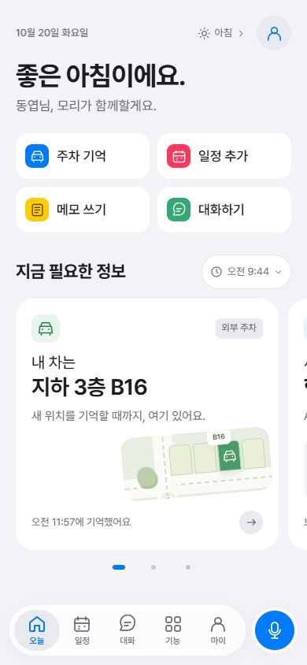
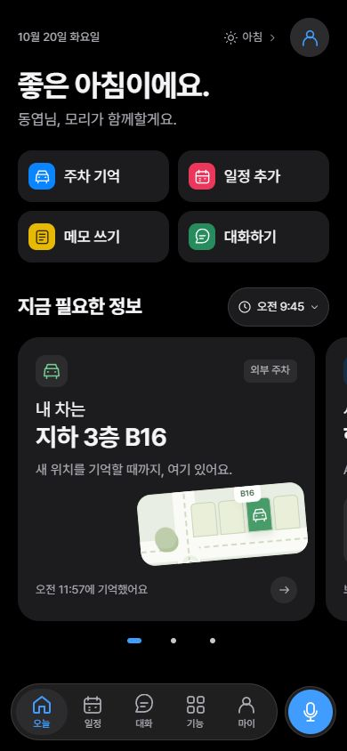
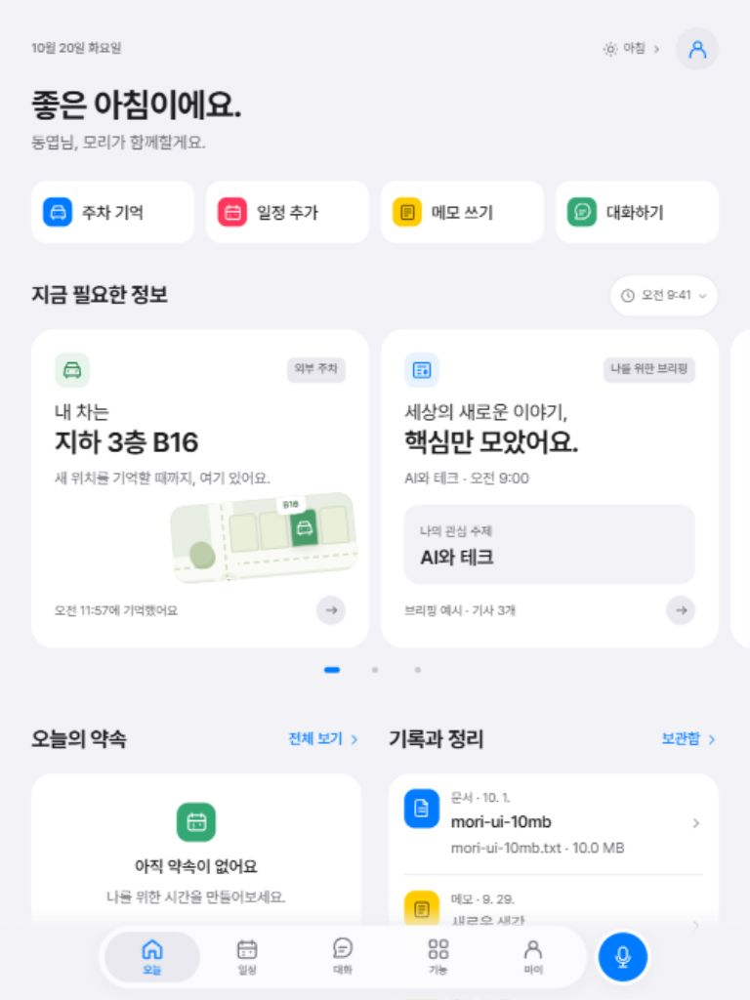

# 모리 모바일·태블릿 UI — 2026-10-20

> 초기 디자인 기록입니다. 현재 구현과 검증은 [모바일 UI 재구성](mobile-ui-redesign.md)을 참고하세요.

휴대폰에서 바로 읽고 실행하는 개인 비서 화면을 기준으로, 태블릿에서는 같은 콘텐츠를 두 열로 확장했습니다. Apple의 Typography·Accessibility·Liquid Glass 가이드에서 글자 위계, 터치 영역, 콘텐츠와 내비게이션의 구분을 참고했습니다.

## PLAN 반영

| 계획의 기준 | 화면에 적용한 내용 |
| --- | --- |
| [전체 계획](../plan.md) 7–11행: 말과 버튼으로 쓰는 단순한 개인 비서, 부모님도 사용 가능한 경험 | 짧은 문구와 눈에 보이는 실행 버튼을 사용합니다. |
| [프론트 계획](../front/plan.md) 9–15행: 오늘 정보와 바로 실행, 큰 버튼, 글자 확대·터치·대비 | 인사 다음에 주차 기억·일정 추가·메모 쓰기·대화하기를 배치하고 실제 정보 카드로 이어집니다. |
| 프론트 계획 45–49행: 쉽게 접근하는 마이크, 대표 버튼 네 개, 필요한 카드와 기록 시각 | 하단 탭 옆 마이크를 모든 탭에서 제공하고 카드에 기록·표시 시각을 유지합니다. |
| 프론트 계획 152–155·249행: 휴대폰·태블릿, 글자 확대·안전 영역·스크롤 | 같은 글자 크기 체계와 내비게이션을 공유하고, 태블릿에서는 카드와 일정·기록 영역을 나란히 배치합니다. |

## 글자와 조작

Apple 기기에서는 시스템 글꼴과 `Apple SD Gothic Neo`를 먼저 사용하고, 다른 환경에서는 로컬 Pretendard와 시스템 글꼴을 사용합니다. 글자 크기는 `rem`으로 정의하며 좁은 화면에서는 줄바꿈과 배치를 조정합니다.

| 역할 | 기본 16px 기준 크기 |
| --- | --- |
| 화면 제목 / 주요 정보 / 섹션 제목 / 카드 제목 | 34 / 28 / 22 / 20px |
| 본문·입력·주요 버튼 / Callout / 보조 설명 | 17 / 16 / 15px |
| 기록 시각·도움말 / 짧은 상태 / 탭 이름 | 13 / 12 / 11px |

핵심 버튼과 아이콘 조작 영역은 최소 44px를 기준으로 구성합니다. 하단의 떠 있는 탭 바와 마이크는 휴대폰·태블릿에서 동일하게 유지합니다. 반투명 소재는 내비게이션에 사용하고, 정보 카드는 라이트·다크 테마의 읽기 쉬운 표면에 표시합니다.

## 구현

- `styles/_refinement.scss`: 글자 역할, 휴대폰·태블릿 배치, 카드·폼·시트·라이트/다크 테마와 반투명 내비게이션.
- `src/app-experience.js`, `index.html`: 네 가지 직접 실행, 기존 정보 카드, 공통 하단 탭과 음성 진입.
- `src/motion.mjs`: 화면·탭·시트·새 메시지 전환. 정기 갱신에서는 진입 효과를 반복하지 않으며 OS의 움직임 줄이기와 앱의 `.reduce-motion` 설정을 따릅니다.

기존 저장 데이터, 대화 초안, 달력 키보드 조작, 시간 범위 탐색과 계정·주차 API 연결을 유지합니다. 음성 입력에서는 전사 내용을 고친 뒤 같은 대화에 담을 수 있습니다.

## 검증 결과

2026-10-20 로컬 Chromium 브라우저에서 확인했습니다. 아래 크기는 CSS 뷰포트 기준입니다.

| 검증 | 결과 |
| --- | --- |
| 휴대폰 세로 | 320×568·375×667에서 화면 5종의 가로 넘침 0px. 390×844에서 주요 흐름과 실제 글자 크기 확인. 375×667에서도 네 실행 버튼과 주차 위치가 하단 탐색보다 위에 표시됨 |
| 휴대폰 가로 | 568×320·844×390 대시보드 가로 넘침 0px, 제목 34px 유지 |
| 태블릿 | 768×1024에서 카드와 하단 목록 두 열. 1024×768에서도 사이드바 없이 같은 탐색 유지, 대시보드·일정 넘침 0px, 월·주·일 전환 확인 |
| 글자·터치·테마 | 제목 34px·본문/입력 17px 측정, 핵심 실행 버튼 높이 58px. 라이트·다크 확인. CSS 루트 글자를 200%로 키운 별도 검증에서 화면 5종 넘침 0px 확인 후 기본 크기로 복원 |
| 주요 조작 | 주차·일정·메모 입력 폼 직접 진입과 Escape 닫기, 대화 진입, 음성 예시를 수정 가능한 채팅 입력으로 전달, 24시간 탐색과 현재 보기 복귀 확인 |
| 빌드·자동 검사 | SCSS 빌드·JavaScript 구문 검사·diff 검사 통과. 전체 자동 테스트 63개 통과 |

실제 iPhone/iPad 하드웨어의 Dynamic Type·키보드·안전 영역·마이크 권한 검증은 별도입니다. 이번 검증은 반응형 브라우저 렌더링과 로컬 시나리오를 대상으로 했으며, 실제 녹음이나 외부 계정 로그인은 진행하지 않았습니다.

## 공식 참고 자료

- [Typography](https://developer.apple.com/design/human-interface-guidelines/typography): iOS/iPadOS 글자 역할과 읽기 쉬운 위계.
- [Accessibility](https://developer.apple.com/design/human-interface-guidelines/accessibility): 글자 확대, 대비, 터치와 보조 기술.
- [Meet Liquid Glass — WWDC25](https://developer.apple.com/videos/play/wwdc2025/219/): 콘텐츠와 내비게이션 레이어, 소재와 상호작용.
- [Calendar 보기 변경](https://support.apple.com/en-lamr/guide/iphone/iphfd1054569/ios): 월·주·여러 날·목록 탐색.
- [Stocks 확인하기](https://support.apple.com/guide/iphone/check-stocks-iph1ac0b1bc/26/ios/26): 관심 종목과 기간별 차트의 정보 위계.
