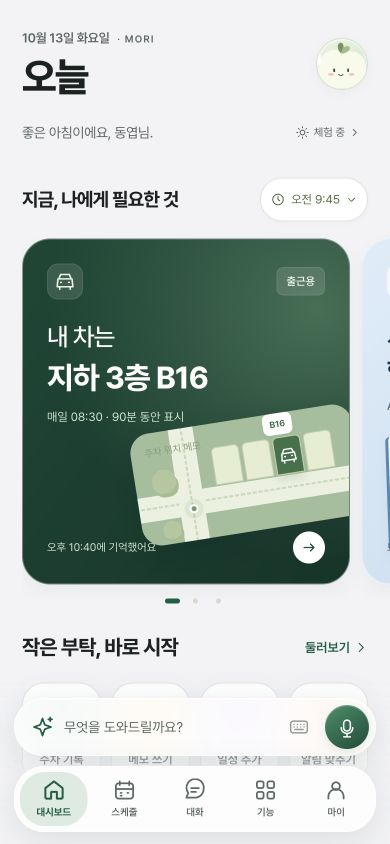
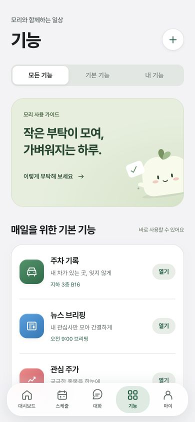
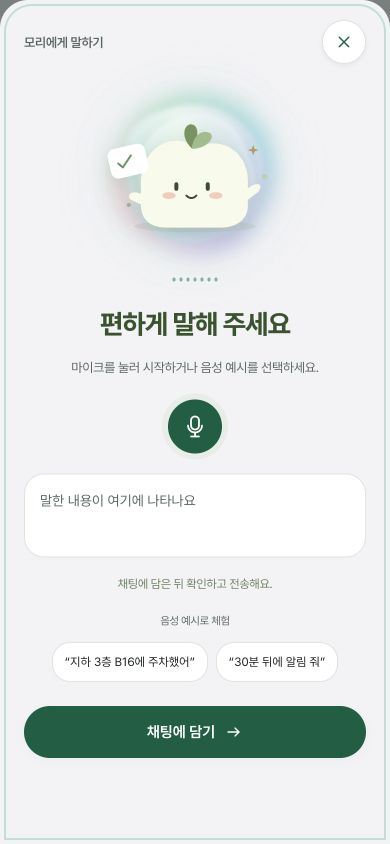

# Mori PoC UI/UX 개편 — 2026-10-13

`poc` 브랜치에서 진행한 디자인 개편입니다. `git pull --ff-only origin poc` 실행 시 원격과 이미 동일한 상태였습니다. HTML·JavaScript·SCSS 구성과 기존 로컬 저장 데이터, 계정 API 연결을 유지했습니다.

후속 화면 전환·음성 입력 개선은 [상호작용 보완 기록](ios-interaction-refinement.md)을 참고하세요. 아래 화면 캡처는 1차 시각 개편 기준입니다.

## 디자인 기준

Apple의 [App Store](https://www.apple.com/app-store/)에서 큰 제목과 편집형 카드, [Notes](https://apps.apple.com/us/app/notes/id1110145109)에서 기록을 검색하고 읽고 편집하는 흐름을 참고했습니다. [Materials](https://developer.apple.com/design/human-interface-guidelines/materials)와 [Tab bars](https://developer.apple.com/design/human-interface-guidelines/tab-bars)를 참고해 반투명 효과는 탐색·입력 컨트롤에 집중했습니다. Siri에서 착안한 빛과 움직임에는 기존 모리 마스코트를 사용합니다. iOS의 실제 시스템 UI 또는 Siri와 연결되는 구현은 아닙니다.

- 배경은 중립적인 밝은 회색, 읽기 영역은 흰색, 브랜드 색은 짙은 초록으로 구분합니다.
- 제목·본문·보조 설명의 크기와 명도를 분리하고, 페이지와 시트의 여백·모서리·버튼 높이를 통일합니다.
- 5개 탭을 같은 순서와 위치에 유지합니다. 선택한 탭은 아이콘과 배경으로 구분합니다.
- 카드 등장·시트 열기·페이지 전환·음성 상태에만 목적에 맞는 움직임을 사용합니다. OS 움직임 줄이기 설정을 존중합니다.

## 화면별 변경

| 영역 | 변경 내용 | 동작 |
| --- | --- | --- |
| 대시보드 | 날짜와 큰 ‘오늘’ 제목, 계정 아바타, 깊이감 있는 시간 카드 | 현재 / 3시간 / 5시간 / 하루 범위와 시간별 가로 목록 유지 |
| 빠른 실행 | 주차·메모·일정·알림을 동일한 아이콘 버튼으로 구성 | 각 기능의 입력·상세 화면으로 직접 이동 |
| 보관함 | 검색, 종류 필터, 결과 수, 최근 기록 목록, 하단 작성 버튼 | 메모 제목·본문, 문서 제목·파일명, 실행 결과 제목·요약 검색. 파일 원문 전체 검색은 아님 |
| 메모 | 종이처럼 읽는 상세 화면, 제목과 본문 중심 편집, 글자 수 | 명시적으로 저장 버튼을 눌러 저장. 기존 편집·삭제·되돌리기 유지 |
| 대화 | 새 이야기 시작 영역, 그룹별 목록, 읽기 쉬운 메시지와 결과 카드 | 검색 시 입력 요소를 교체하지 않아 한글 조합·포커스를 유지 |
| 음성 | 빛이 도는 모리, 대기 표시, 녹음 중 파형, 상태 안내 | 예시 또는 브라우저 음성 인식 → 수정 → 같은 채팅 초안에 담기 → 사용자가 전송 |
| 기능 | 큰 사용 가이드 카드, 아이콘·설명·현재 상태·열기 버튼으로 된 목록 | 기본 / 내 기능 필터, 기존 상세·사용자 기능 만들기 연결 |
| 스케줄 | 새 글자·색·탭·시트 스타일 적용 | 기존 월·주·일과 직접 입력 유지. 359px 이하에서는 입력란을 한 열로 배치 |
| 마이 | 계정 카드·설정 그룹·요금제 안내의 시각 체계 통일 | 기존 소셜 로그인·프로필·테마·요금제 API 동작 유지 |

## 소스

- `src/app-experience.js`: 화면 구조, 검색 결과 부분 갱신, 메모 편집, 페이지 전환.
- `index.html`: 음성 마스코트/파형, 빠른 입력 UI, 접근성 상태 안내.
- `styles/_ios-experience.scss`: 이번 개편의 토큰과 화면 스타일. `experience.scss` 마지막에서 mixin으로 포함합니다.
- `styles/main.css`: `npm run build`로 생성되는 배포용 CSS.

## 검증

- `npm run check`, `npm run build`, `npm test` 실행. 기존 56개 테스트 통과.
- 브라우저에서 390×844, 320×568, 844×390, 834×1112 및 기본 데스크톱 크기를 확인.
- 메모 생성·저장·본문 줄바꿈·글자 수·검색 결과 확인 후 검증용 메모 삭제.
- 보관함과 대화 검색, 기능 필터, 시간 범위 메뉴, 일정 소요 시간 선택, 음성 예시를 같은 채팅 초안으로 넘기는 동작 확인.
- 다크/라이트 전환, 선택 탭 표시, 태블릿 다섯 탭의 가로 넘침 여부 확인. 검증 중 브라우저 경고/오류 로그 없음.
- 실제 마이크 권한/음성 인식 서버, 실기기 소프트 키보드, OS 알림, 실제 결제 또는 Hermes 통신을 새로 검증한 것은 아닙니다. 기존 PoC 경계를 유지합니다.

## 확인

`npm start` 후 <http://localhost:4173/#dashboard>에서 확인합니다.

