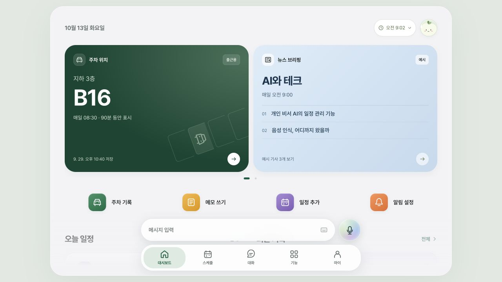
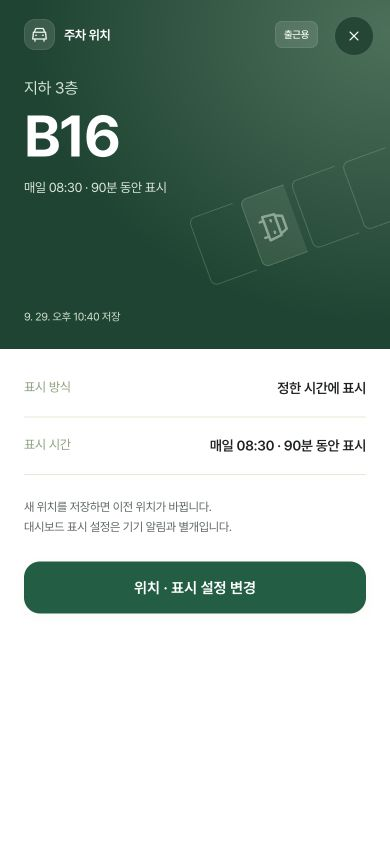
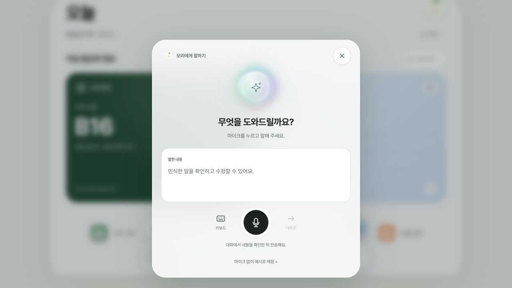
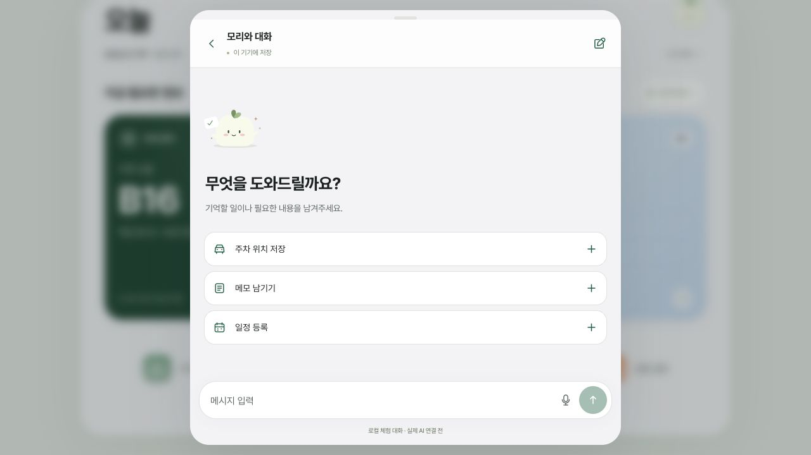

# Mori 화면 전환·입력 경험 보완

2026-10-13, `poc` 브랜치. 이전 시각 개편에 이어 대시보드의 정보 구조, 상세 진입, 채팅과 음성 입력의 동작을 수정했다.

## 설계 기준

Apple의 [Motion 가이드](https://developer.apple.com/design/human-interface-guidelines/motion)와 [WWDC24 전환 설명·예시](https://developer.apple.com/videos/play/wwdc2024/10145/)를 참고했다. 큰 카드와 상세 화면 사이에서는 공통 요소를 이어 보여주고, 전환 중의 닫기와 제스처도 처리하는 원칙을 적용했다. 누른 항목과 다음 화면의 관계가 이어져 보이도록 하고, 사용자 조작을 기다리게 하는 장식적 움직임은 줄였다. 구현은 HTML dialog와 Web Animations API 기반이며 iOS 시스템 전환을 직접 사용하는 것은 아니다.

## 적용 내용

| 영역 | 바뀐 동작 |
| --- | --- |
| 주차 카드 → 상세 | 같은 제목·자리 번호·배경을 유지하고 표면의 경계가 펼쳐진다. 글자와 버튼에 가로·세로가 다른 확대를 적용하지 않는다. 설정 내용과 닫기 버튼은 뒤이어 나타난다. 닫으면 같은 카드로 접힌다. |
| 그 밖의 상세 | 공통 시각 요소가 없는 항목은 짧은 이동·페이드로 진입한다. 원래 카드가 화면 밖에 있거나 상세 내용을 스크롤한 경우에도 무리하게 카드 모양으로 축소하지 않는다. |
| 상세 → 설정·편집 | 상세 화면의 틀을 유지하고 내용이 옆으로 전환된다. 뒤로가기 버튼이나 Escape로 이전 상세로 돌아간다. 저장 후에는 최신 데이터를 다시 읽어 표시한다. |
| 닫기 | 닫기 버튼, 바깥 영역, Escape, 상단 드래그를 지원한다. 짧은 드래그는 제자리로 복귀한다. 본문 스크롤과 텍스트 선택은 드래그 닫기에 사용하지 않는다. |
| 빠른 입력 | 키보드 요청 버튼과 원형 음성 버튼을 분리한다. 채팅은 전체 대화 영역으로 올라오고, 음성은 현재 화면 위에 별도 패널로 나타난다. |
| 음성 → 채팅 | 음성 진입만으로 채팅을 열지 않는다. 인식한 문장을 수정한 뒤 ‘대화로’ 또는 ‘키보드’를 누르면 초안으로 전달한다. 기존 채팅에서 진입한 경우 같은 대화의 초안에 이어 붙인다. 자동 전송하지 않는다. |
| 대시보드 내용 | 주차는 층·자리 번호, 뉴스는 주제·예시 기사, 주가는 가격을 먼저 보여준다. 오늘 일정, 최근 기록, 최근 대화 순으로 이어지며 메모는 본문 미리보기가 있는 카드로 표시한다. |
| 시간 범위 | 현재·3시간·5시간·하루 선택을 유지한다. 범위 요약을 간소화하고 시간별 카드의 색과 제목을 기본 대시보드에 맞춘다. 조회 범위 선택만으로 작업을 실행하지 않는다. |
| 문구 | 과도한 감성 문구와 강제 줄바꿈을 줄였다. ‘지금 필요한 정보’, ‘오늘 일정’, ‘최근 기록’ 등 실제 내용과 동작을 표현한다. 사용자가 저장한 메모와 대화는 덮어쓰지 않는다. |
| 화면 크기 | 작은 높이에서는 대시보드 카드를 줄인다. 음성 패널은 내용에 맞춰 높이를 정하고, 가로 화면에서는 내부 스크롤로 모든 컨트롤에 접근한다. |

상세 화면은 현재 탭 위에 표시하는 모달 방식이다. 상세 항목별 독립 URL이나 브라우저 히스토리 라우터를 추가한 것은 아니다. 탭을 오갈 때의 세로 스크롤 위치는 세션 동안 기억한다.

## 대시보드 정보 밀도·입력 정렬 후속 수정

- 큰 ‘오늘’ 제목, 이름을 넣은 인사말, 일정 0개 요약을 제거했다. 날짜·표시 시간 범위·계정 버튼만 한 줄로 두고 바로 주차·뉴스 등 실제 내용으로 이어진다.
- ‘시간 체험’ 버튼은 시간 범위 메뉴 안의 ‘체험 시간 변경’으로 옮겼다. 3시간·5시간·하루 조회 기능은 유지한다.
- 현재 정보가 없을 때는 ‘현재 표시할 정보가 없어요’로 표시한다. 빈 일정의 중복 안내와 시간별 목록의 반복 설명을 줄였다.
- 하단 버튼은 ‘메시지 입력’과 음성 입력으로 표시한다. 두 버튼은 같은 높이 변수를 사용하며 세로 화면 56px, 낮은 가로 화면 48px로 위아래 끝선을 맞췄다.
- 브라우저에서 390×844, 320×568, 844×390의 버튼 실제 높이·상단·하단 좌표가 일치함을 확인했다. 시간 범위 선택, 체험 메뉴, 채팅·음성 진입을 확인했고 60개 테스트와 빌드·문법 검사도 통과했다.

## 주차 카드 전환 재구현

- 이전 전환은 상세 화면 전체를 서로 다른 X/Y 배율로 축소해 카드에 맞췄다. 글자·버튼까지 눌려 보이는 원인이어서 제거했다.
- 카드와 상세 상단이 `parkingFace()`를 공유한다. 제목, 층, 자리 번호, 표시 시간, 저장 시각, 주차 도형의 위치를 연결한다.
- `cardGeometry()`는 이동과 둥근 사각형의 클리핑 범위만 계산한다. 표면의 크기가 바뀌어도 본문은 본래 비율을 유지한다. 공통 글자의 크기 변경이 필요한 경우에만 균일 배율을 사용한다.
- 주차 상세는 모바일에서 화면을 채우고, 넓은 화면에서는 가운데에 열린다. 상단 제목 바를 별도로 끼우지 않고 카드 위에 닫기 버튼을 둔다.
- 진입 500ms, 복귀 360ms. 배경의 어두워짐·흐림을 함께 조절한다. OS 움직임 줄이기에서는 이 전환을 생략한다.
- 짧은 드래그 복귀, 긴 드래그 닫기, 진입 중 Escape, 설정 편집 화면 왕복과 원래 카드의 포커스 복귀를 브라우저에서 확인했다. 주차 도형의 반투명도도 전환 중 유지한다.
- 390×844 모바일과 1280×720 데스크톱에서 중간 전환 프레임의 행렬 배율이 1인 것을 확인했다. iOS 실기기의 시스템 전환 자체를 사용하는 구현은 아니다.

## 구현

- `src/presentation.mjs`: 진입·복귀·내용 교체·상단 드래그 전환. 전환 중 닫기/재열기를 처리하고 OS 움직임 줄이기를 따른다. native dialog의 모달 포커스 제어를 유지한다.
- `src/app-experience.js`: 상세 탐색 이력, 대시보드 콘텐츠, 초안을 보존하는 음성/채팅 전환, 음성 인식 세션 종료 처리.
- `src/experience.mjs`, `src/dashboard-timeline.mjs`: 기본 기능과 시간 범위의 설명 문구. 데이터 처리 규칙은 유지한다.
- `index.html`, `styles/_ios-experience.scss`, `styles/main.css`: 입력 컨트롤·음성 패널 구조와 반응형 스타일. CSS는 `npm run build` 결과다.
- `tests/presentation.test.mjs`: 움직임 줄이기, 닫기 중 재열기, 중복 닫기, 재렌더된 원래 카드로 포커스 복귀를 검증한다.

## 검증 결과

- `npm run build`, `npm run check`, `npm test`, `git diff --check` 통과. 테스트는 기존 56개 + 전환 수명주기·기하·시각 속성 8개, 총 64개다.
- 390×844, 320×568, 834×1112, 844×390 크기에서 브라우저로 확인했다.
- 주차·주가·메모 상세, 설정/편집 왕복, Escape, 원래 기록으로 포커스 및 스크롤 복귀를 확인했다.
- 포인터로 상단을 길게 끌면 닫히고, 짧게 끌면 화면이 유지되는 것을 확인했다.
- 대시보드에서 음성만 열리는 것, 예시 문장을 채팅 초안으로 넘기는 것, 기존 초안에 음성을 이어 붙이는 것, 빈 음성에서 키보드로 전환하는 것을 확인했다. 검증용 초안은 비웠다.
- 시간 범위 선택과 기능 목록, 라이트·다크 테마를 확인했다. 테마는 기존 라이트로 복원했다. 대시보드는 아침 시간 체험 상태로 확인할 수 있다.
- 확인한 브라우저 세션에 오류/경고 로그가 없었다. 실제 마이크 권한·음성 인식 서비스, 실기기 터치·소프트 키보드는 별도 검증 대상이다. 실제 Hermes 통신·푸시·뉴스 수집·시세 연결 범위는 변경하지 않았다.

## 미리보기

`npm start` 실행 후 <http://localhost:4173/#dashboard>.

