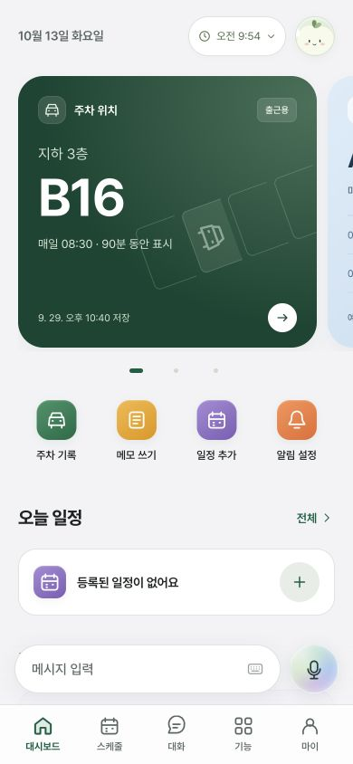
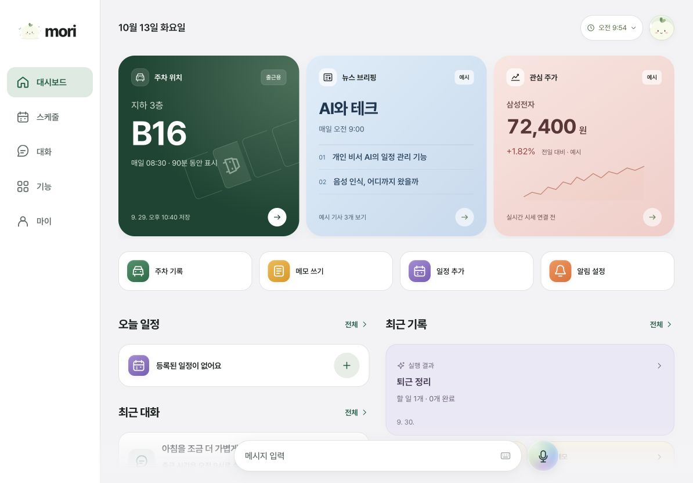

# Mori 모바일·태블릿 화면 구성

2026-10-13 · `poc` 브랜치. 같은 HTML 화면을 기기 이름이 아니라 실제 창 크기에 맞춰 배치한다. iPad의 분할 화면처럼 폭이 줄어들면 하단 탭 구성으로 돌아온다.

## 화면별 구성

| 화면 조건 | 구성 |
| --- | --- |
| 휴대폰·좁은 창 | 화면 가장자리에 고정한 하단 5개 탭, 그 위에 같은 높이의 메시지·음성 버튼. 대시보드 카드는 한 장과 다음 카드 일부를 보여주며 옆으로 넘긴다. |
| 폭 700px 이상, 높이 600px 이상 | 현재 정보 카드는 두 장씩 보여준다. 일정과 최근 대화를 왼쪽에, 기록을 오른쪽에 배치한다. 넘칠 때만 이전·다음 버튼과 표시 범위를 보여준다. |
| 폭 1000px 이상, 높이 600px 이상 | 같은 탐색 버튼이 왼쪽 메뉴로 이동한다. 메시지·음성 입력은 본문 아래에 유지한다. 기존 웹 미리보기의 외곽 프레임과 큰 그림자를 없앤다. |
| 폭 1180px 이상, 높이 600px 이상 | 현재 정보 카드를 세 장씩 보여준다. 모두 보일 때는 카드 탐색 컨트롤을 숨긴다. |
| 높이가 낮은 가로 화면 | 하단 메뉴를 낮추고 아이콘과 이름을 가로로 배치한다. 시트 안의 내용을 스크롤할 수 있게 한다. |

휴대폰의 상세·채팅은 화면을 채운다. 태블릿에서는 배경 문맥을 남긴 채 최대 600–620px의 패널로 열린다. 일반 입력은 시트, 음성은 별도 패널을 사용한다. 상세 화면은 여전히 모달이며 뒤의 화면을 동시에 조작하는 분할 보기로 바뀐 것은 아니다.

## 조작과 가독성

- 메시지 버튼과 마이크의 높이는 54px로 일치하며, 낮은 가로 창에서는 48px다.
- 카드 페이지 점, 닫기, 보기 방식 전환 등 작은 컨트롤의 터치 영역을 키웠다. 호버로 올라가는 효과는 추가하지 않았다.
- 탭 이동 시 각 화면의 스크롤 위치를 유지한다. 화면 크기만 바뀌어도 기존 탭·대화·입력 내용은 유지된다.
- 카드 탐색은 `ResizeObserver`로 보이는 카드 수와 버튼 상태를 갱신한다. 끝에 도달하면 다음 버튼을 비활성화한다.
- 계정 화면의 읽기 폭을 제한하고 대화 기록은 한 줄 목록으로 유지한다. 기능 목록의 보조 설명과 기록 본문 글자를 키웠다.
- 스케줄의 빈 상태는 현재 상태와 가능한 행동을 설명하도록 줄였다.
- 입력창에 포커스가 있고 소프트 키보드로 가시 영역이 줄어들면 `VisualViewport`를 기준으로 시트 높이·위치를 제한한다. 핀치 확대 상태에서는 이 보정을 적용하지 않는다.
- 화면 안전 영역, 다크 모드, 움직임 줄이기와 투명도 줄이기를 고려했다.

## 변경 파일

- `styles/_adaptive-experience.scss`: 반응형 창 구조, 하단/측면 탐색, 대시보드 열 배치, 시트·키보드 대응.
- `styles/experience.scss`: 반응형 스타일 모듈 포함. `styles/main.css`는 빌드 결과.
- `src/app-experience.js`: 콘텐츠 폭을 제한하는 래퍼, 대시보드 배치, 카드 탐색 동기화, 가시 영역 감지, 일부 안내 문구.
- `index.html`: 넓은 화면의 모리 탐색 버튼.

## 확인 결과

- `npm run build`, `npm run check`, `npm test` 통과. 기존 테스트 64개 통과.
- 320×568, 834×1112, 1024×768, 844×390에서 다섯 탭의 가로 넘침이 없고 탐색 버튼이 창 안에 위치하는 것을 확인했다.
- 390×844와 1194×834에서 대시보드·상세·채팅·음성 패널을 시각적으로 확인했다.
- 태블릿 카드 탐색에서 `1–2 / 3` → `2–3 / 3`과 끝에서 다음 버튼 비활성화를 확인했다. 3시간 범위 목록도 확인했다.
- 320px 폭에서 일정 입력 시트가 가로로 넘치지 않았다. 음성 → 키보드 전환, 주차 상세 닫기, 라이트·다크 전환을 확인했다.
- 브라우저 크기 변경으로 검사한 결과다. 실제 iPhone/iPad의 소프트 키보드·노치·터치 스크롤은 별도 실기기 검증이 필요하다. 이번 작업으로 실제 AI 통신이나 앱 배포를 추가한 것은 아니다.

미리보기: <http://localhost:4173/#dashboard>

